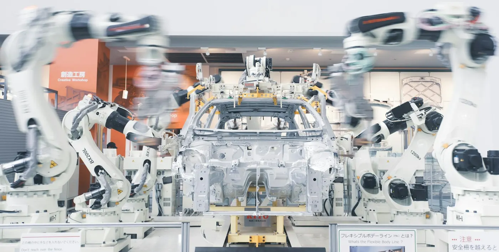
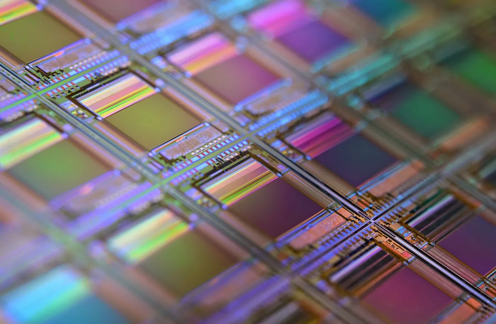
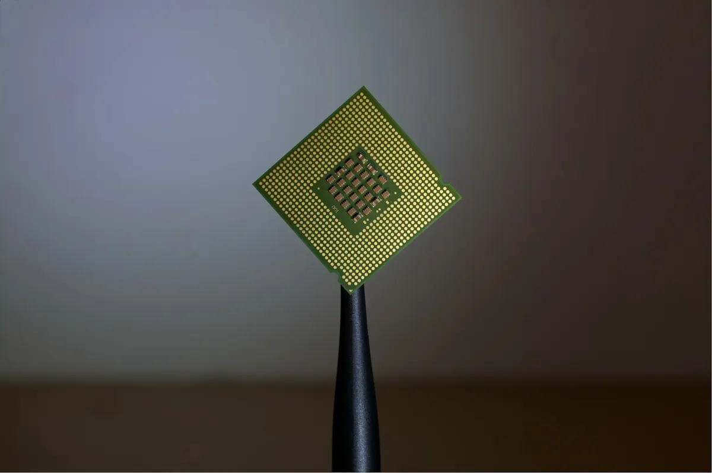

import ChipJourney from "@/components/blog/chip/ChipJourney.astro";
import HowSmall from "@/components/blog/chip/HowSmall.astro";
import EuvLight from "@/components/blog/chip/EuvLight.astro";
import LeadingEdge from "@/components/blog/chip/LeadingEdge.astro";
import RevenueRace from "@/components/blog/chip/RevenueRace.astro";
import FoundryShare from "@/components/blog/chip/FoundryShare.astro";
import Chokepoints from "@/components/blog/chip/Chokepoints.astro";

Ở bài [Silicon Valley](/writing/silicon-valley), mình đã viết về transistor, mạch tích hợp, Fairchild và Intel. Bài đó dừng lại ở thời điểm con chip được phát minh ở California. Bài này kể tiếp phần sau: vì sao hơn 60 năm sau, phần lớn những con chip tiên tiến nhất lại được làm ở một hòn đảo cách California hơn 10.000 km, bằng những cỗ máy mà chỉ một công ty ở Hà Lan làm được.

Mình bắt đầu để ý chuyện này từ năm 2021. Năm đó các nhà máy ô tô trên khắp thế giới phải dừng dây chuyền vì thiếu chip. Thứ bị thiếu thường là những con chip rẻ, vài đô một con, dùng để điều khiển cửa kính hay túi khí. AlixPartners ước tính ngành ô tô mất khoảng 210 tỷ USD doanh thu trong năm 2021, tương đương 7,7 triệu chiếc xe không được sản xuất. Một trong những lý do được nhắc tới là các đợt phong tỏa vì COVID ở Malaysia, nơi có rất nhiều nhà máy đóng gói chip[^alix].

Một cái xe cần hàng nghìn bộ phận, chỉ thiếu một con chip là không xuất xưởng được. Và con chip đó lại phụ thuộc vào một chuỗi cung ứng trải qua nhiều nước, mà mỗi khâu chỉ có vài công ty làm được. Mình muốn hiểu chuỗi này hình thành thế nào, nên đọc và ghi lại ở đây. Phần lịch sử chủ yếu dựa trên cuốn _Chip War_ của Chris Miller[^chipwar] và các nguồn trong phần chú thích.

## Phần 1: Một con chip được làm ra như thế nào

Con chip là một mảnh silicon nhỏ chứa rất nhiều transistor, những công tắc tí hon bật tắt dòng điện. Một con chip xử lý trong điện thoại bây giờ có hơn 10 tỷ transistor[^mittr]. Làm ra nó cần nhiều khâu, và mỗi khâu gần như là một ngành riêng.

**Thiết kế.** Kỹ sư vẽ ra mạch điện bằng phần mềm thiết kế chuyên dụng, gọi là EDA. Kết quả là một bản vẽ gồm hàng chục lớp, mỗi lớp là một mẫu hình cực nhỏ.

**Wafer và vật liệu.** Silicon được tinh chế, nấu chảy, kéo thành thỏi rồi cắt thành những tấm tròn mỏng gọi là wafer, thường có đường kính 300mm. Ngoài silicon còn cần hàng trăm loại hóa chất và khí siêu tinh khiết.

**Sản xuất (front-end).** Đây là khâu khó nhất. Nhà máy phủ lên wafer một lớp hóa chất nhạy sáng gọi là chất cản quang, rồi chiếu ánh sáng qua một tấm mặt nạ để in mẫu hình của một lớp lên đó. Cách in bằng ánh sáng này gọi là **quang khắc** (photolithography). Sau đó họ khắc, phủ vật liệu, rửa, rồi lặp lại cho lớp tiếp theo. Một con chip hiện đại cần khoảng một nghìn bước như vậy và mất vài tháng[^viettimes].

**Đóng gói và kiểm thử (back-end).** Wafer được cắt ra thành từng con chip, mỗi con được gắn vào một lớp vỏ có chân nối, rồi được kiểm tra xem có chạy đúng không.

**Lắp ráp.** Con chip được hàn lên bo mạch và đi vào điện thoại, máy tính, ô tô.

Vài từ sẽ gặp nhiều trong bài:

- **Fab** là nhà máy sản xuất chip.
- **Foundry** là công ty chỉ sản xuất chip theo thiết kế của khách hàng, như TSMC.
- **Fabless** là công ty chỉ thiết kế mà không có nhà máy, như Apple, Nvidia, Qualcomm.
- **IDM** là công ty tự thiết kế và tự sản xuất, như Intel hay Samsung.
- **Tiến trình** (node) là thế hệ công nghệ sản xuất, như "3nm" hay "2nm". Con số càng nhỏ thì transistor càng nhỏ và càng nhét được nhiều trên một con chip.

Từng khâu ở trên nằm ở đâu trên bản đồ thì có thể xem ở hình dưới. Bấm qua từng bước để đi theo con chip.

<ChipJourney />

Một chi tiết hay bị hiểu nhầm là tên của tiến trình. Từ khoảng cuối thập niên 1990, cái tên "3nm" hay "5nm" không còn ứng với kích thước thật của bất kỳ bộ phận nào trên chip nữa. Nó là tên thương mại cho một thế hệ công nghệ. Kích thước thật vẫn rất nhỏ: khoảng cách giữa hai cực cổng của transistor ở tiến trình 3nm của TSMC vào khoảng 48nm[^wikichip]. Để thấy con số này nhỏ cỡ nào, kéo thanh trượt bên dưới.

<HowSmall />

Thứ quyết định ta in được nét nhỏ đến đâu là bước sóng của ánh sáng dùng để in. Muốn vẽ nét mảnh thì cần bút mảnh. Phần lớn lịch sử của ngành chip, và phần lớn câu chuyện về ASML ở dưới, xoay quanh việc tìm ra loại ánh sáng có bước sóng ngắn hơn.

## Phần 2: Lịch sử

### Cái kính hiển vi lật ngược

Năm 1947, transistor ra đời ở Bell Labs. Cuối thập niên 1950, Jack Kilby ở Texas Instruments và Robert Noyce ở Fairchild cùng tìm ra cách đặt nhiều transistor lên một mảnh vật liệu, tạo ra mạch tích hợp. Phần này mình đã kể ở bài Silicon Valley.

Vấn đề tiếp theo là làm sao vẽ được những mạch nhỏ như vậy. Lời giải đến từ một phòng thí nghiệm quân sự. Giữa thập niên 1950, Jay Lathrop làm việc ở Phòng thí nghiệm ngòi nổ Diamond của Quân đội Mỹ, nhiệm vụ là thu nhỏ ngòi nổ cho đạn pháo. Ông nghĩ ra một mẹo: lật ngược ống kính của kính hiển vi. Bình thường kính hiển vi phóng to một vật nhỏ. Lật ngược lại, nó thu nhỏ một hình lớn và chiếu lên một bề mặt đã phủ hóa chất nhạy sáng. Năm 1957, Lathrop và đồng nghiệp James Nall đăng ký bằng sáng chế cho cách làm này, và quân đội thưởng cho ông 25.000 USD. Sau đó Lathrop chuyển sang làm cho Texas Instruments[^mittr]. Quang khắc ra đời như vậy, và hơn 60 năm sau mọi con chip vẫn được làm theo nguyên lý đó.

Khách hàng đầu tiên của mạch tích hợp cũng là quân đội và NASA. Năm 1962, Texas Instruments nhận hợp đồng thiết kế 22 loại mạch cho hệ thống dẫn đường của tên lửa Minuteman II. Máy tính dẫn đường của tàu Apollo dùng khoảng 200.000 con chip, mỗi con giá 20 đến 30 USD, và là khách hàng lớn nhất của mạch tích hợp cho tới năm 1965[^chm]. Thời đó chip đắt hơn nhiều lần so với transistor rời, chỉ có quân đội và chương trình vũ trụ mới trả nổi. Nhưng những đơn hàng lớn này giúp các hãng sản xuất học được cách làm nhiều và rẻ, rồi đem chip vào máy tính, máy tính bỏ túi và đồ điện tử dân dụng.

### Đưa nhà máy sang châu Á

Khâu cuối của việc làm chip thời đó cần rất nhiều sức người. Công nhân, phần lớn là phụ nữ, ngồi trước kính hiển vi để hàn những sợi dây vàng mảnh hơn sợi tóc nối con chip với vỏ của nó. Lương công nhân ở California cao, nên các hãng chip Mỹ bắt đầu tìm nơi khác.

Fairchild mở xưởng lắp ráp ở Hồng Kông vào giữa thập niên 1960. Texas Instruments theo sau với Singapore năm 1968, Đài Loan năm 1969, Malaysia năm 1972 và Philippines năm 1979. Motorola cũng có mặt ở Kuala Lumpur từ năm 1972[^rhines]. Chỉ trong khoảng mười năm, khâu lắp ráp chip của Mỹ gần như đã chuyển hết sang châu Á.

Theo Chris Miller, ngoài tiền công còn có lý do chính trị. Đó là thời Chiến tranh Lạnh và chiến tranh Việt Nam. Những nhà máy điện tử tạo ra việc làm và gắn kinh tế của các nước như Đài Loan, Singapore, Malaysia với Mỹ, và chính phủ các nước đó cũng chủ động mời các hãng chip Mỹ vào[^chipwar]. Những nhà máy lắp ráp này chính là điểm khởi đầu cho ngành bán dẫn của Đài Loan và Malaysia sau này.

### Nhật Bản vượt mặt Mỹ

Trong khi đó, Nhật Bản đi một con đường khác. Họ không chỉ lắp ráp mà còn tự sản xuất chip, đặc biệt là chip nhớ DRAM, loại chip dùng làm bộ nhớ tạm cho máy tính. DRAM là sản phẩm cần sản xuất số lượng lớn với tỷ lệ lỗi thấp, đúng thế mạnh của các tập đoàn như NEC, Toshiba, Hitachi và Fujitsu.

Tốc độ đuổi kịp rất nhanh. Năm 1980, các hãng Nhật chỉ chiếm khoảng 25% thị trường bán dẫn thế giới, còn Mỹ chiếm hơn một nửa. Năm 1981, Nhật vượt Mỹ về thị phần chip nhớ 64K DRAM. Năm 1986, Nhật trở thành nước cung cấp chip bán dẫn lớn nhất thế giới, sáu trong mười hãng chip lớn nhất là của Nhật. Đến năm 1987, thị phần DRAM của Nhật lên tới khoảng 80%[^shmj].

Intel, công ty đã tạo ra chip DRAM thương mại đầu tiên, bị dồn vào chân tường. Andy Grove kể lại cuộc nói chuyện với Gordon Moore năm 1985. Grove hỏi: "Nếu chúng ta bị đuổi và hội đồng quản trị đưa một CEO mới vào, ông nghĩ người đó sẽ làm gì?". Moore trả lời ngay: "Ông ta sẽ đưa chúng ta ra khỏi mảng bộ nhớ." Grove nói: "Vậy sao hai chúng ta không bước ra ngoài, rồi quay lại và tự làm việc đó?"[^grove] Intel bỏ DRAM để dồn sức vào bộ vi xử lý, một quyết định về sau cứu công ty.

Washington coi đây là vấn đề an ninh quốc gia. Tháng 9 năm 1986, Mỹ và Nhật ký Hiệp định bán dẫn, buộc Nhật mở cửa thị trường cho chip nước ngoài và ngừng bán phá giá[^shmj]. Năm 1987, Mỹ lập Sematech, một liên minh nghiên cứu giữa chính phủ và các hãng chip, do Robert Noyce đứng đầu[^mittr].

Cuộc thua này còn kéo theo một lĩnh vực khác: máy quang khắc. Những năm 1970, các hãng Mỹ như Perkin-Elmer và GCA dẫn đầu thị trường máy in mạch. Khi các hãng chip Nhật lớn lên, họ mua máy của Nikon và Canon. Đến cuối thập niên 1980, GCA gần phá sản. Sematech bơm hàng triệu USD vào GCA nhưng công ty vẫn sụp đổ. Bước sang thập niên 1990, thị trường máy quang khắc chỉ còn ba tên tuổi lớn: hai của Nhật và một của Hà Lan[^mittr].

Thời hoàng kim của chip Nhật không kéo dài. Năm 1993, ngành bán dẫn Mỹ giành lại vị trí số một[^shmj]. Nền kinh tế bong bóng của Nhật vỡ, và một đối thủ mới ở ngay bên cạnh đã bắt đầu đuổi theo.

### Canh bạc của Samsung

Năm 1983, Lee Byung-chul, người sáng lập Samsung, công bố cái mà người Hàn gọi là "Tuyên bố Tokyo": Samsung sẽ bước vào ngành bán dẫn, bắt đầu từ chip DRAM. Khi đó gần như ai cũng nghĩ đây là quyết định liều lĩnh, vì Samsung đi sau Mỹ và Nhật nhiều năm. Samsung bắt tay vào làm từ tháng 5 và đến ngày 1 tháng 12 năm 1983 đã làm ra con chip 64K DRAM đầu tiên của Hàn Quốc[^tokyo].

Samsung chịu lỗ nhiều năm liền, liên tục xây nhà máy mới kể cả khi giá chip đang giảm. Cách chơi này về sau thành thương hiệu của họ: đầu tư mạnh nhất đúng lúc đối thủ phải cắt giảm. Tháng 8 năm 1994, Samsung làm ra con chip DRAM 256 megabit đầu tiên trên thế giới và trở thành nhà sản xuất chip nhớ lớn nhất thế giới[^samsung]. Đến nay chip nhớ vẫn là mảng mà Hàn Quốc nắm chắc nhất.

### Đài Loan và Morris Chang

Đài Loan đi theo một con đường có kế hoạch rõ hơn. Năm 1973, chính phủ lập Viện Nghiên cứu Công nghệ Công nghiệp (ITRI). Năm 1974, Bộ trưởng Kinh tế Tôn Vận Tuyền (Sun Yun-suan) họp với các chuyên gia để bàn về việc xây dựng ngành bán dẫn[^itri]. Năm 1976, ITRI ký hợp đồng chuyển giao công nghệ với hãng RCA của Mỹ và gửi bốn nhóm kỹ sư sang Mỹ học. Năm 1977, ITRI xây xưởng wafer 3 inch đầu tiên của Đài Loan. Năm 1980, công ty UMC được tách ra từ xưởng thử nghiệm của ITRI, và Khu Khoa học Tân Trúc (Hsinchu) ra đời[^twsemi].

Morris Chang (Trương Trung Mưu), người sau này lập ra TSMC, sinh năm 1931 ở Ninh Ba, Trung Quốc. Ông vào Harvard năm 1949 rồi chuyển sang MIT, học kỹ sư cơ khí, và trượt hai lần kỳ thi đủ điều kiện làm tiến sĩ nên rời MIT mà không có bằng. Năm 1955 ông làm cho Sylvania, năm 1958 chuyển sang Texas Instruments và ở đó 25 năm[^chang]. Ông lên tới chức phó chủ tịch phụ trách toàn bộ mảng bán dẫn của TI, và nổi tiếng với cách định giá chip thấp ngay từ đầu, chấp nhận lãi ít để chiếm thị phần, rồi nhờ sản lượng lớn mà giảm chi phí[^chang]. Cuối thập niên 1970, TI chuyển trọng tâm sang máy tính bỏ túi, đồng hồ điện tử và máy tính gia đình. Chang thấy sự nghiệp ở TI đã đi vào ngõ cụt và rời công ty năm 1983[^chang][^caixin].

Năm 1985, chính phủ Đài Loan mời ông về làm viện trưởng ITRI[^caixin]. Ông mang về một ý tưởng mà nhiều người trong ngành coi là kỳ lạ: lập một công ty chỉ sản xuất chip cho người khác, không bao giờ tự thiết kế chip của riêng mình.

Thời đó, làm chip có nghĩa là vừa thiết kế vừa sản xuất. Jerry Sanders, sáng lập viên của AMD, có câu nói nổi tiếng: "Đàn ông thật sự thì phải có nhà máy" ("Real men have fabs")[^sanders]. Nhưng Chang thấy một xu hướng khác. Cuốn sách _Introduction to VLSI Systems_ của Carver Mead và Lynn Conway, xuất bản năm 1980, đã chuẩn hóa cách thiết kế chip, cho phép người thiết kế làm việc tách biệt với nhà máy[^meadconway]. Chang đoán rằng sẽ có rất nhiều công ty chỉ muốn thiết kế, và họ sẽ cần một nơi đáng tin để sản xuất.

Ông đi gọi vốn. Ông tìm đến Intel, Toshiba, Hitachi, Sony. Intel tỏ ra quan tâm lúc đầu, nhưng sau hai lần gặp, Craig Barrett của Intel từ chối. Chang kể lại: "Công ty duy nhất có vẻ thật sự quan tâm là Philips"[^benzinga]. Năm 1987, TSMC ra đời. Chính phủ Đài Loan góp 48,3% vốn, Philips góp 27,6% để đổi lấy việc chuyển giao công nghệ và bằng sáng chế, phần còn lại do các doanh nghiệp tư nhân Đài Loan góp[^tsmcwiki][^caixin].

Những năm đầu rất khó. Năm 1988, Intel thuê TSMC sản xuất một loại vi điều khiển, và đơn hàng này như một lời chứng nhận cho năng lực của TSMC, giúp họ có thêm khách hàng[^caixin]. Doanh thu năm 1990 của TSMC khoảng 70 triệu USD. Năm 1995, con số này là 1,1 tỷ USD[^caixin].

Ý tưởng của Chang đúng thời điểm. Từ cuối thập niên 1980, hàng loạt công ty fabless ra đời: Qualcomm, Broadcom, Nvidia. Năm 1997, Nvidia gần phá sản thì nhận được một cuộc gọi từ Morris Chang, và từ đó hai công ty bắt đầu hợp tác[^caixin]. Jensen Huang sau này nói: "Nvidia sẽ không tồn tại đến hôm nay nếu không có TSMC"[^caixin]. Còn AMD, công ty của câu nói "đàn ông thật sự thì phải có nhà máy", đến năm 2009 đã tách mảng sản xuất của mình ra thành GlobalFoundries[^sanders].

Có một nguyên tắc giúp TSMC giữ khách: họ không bán chip mang thương hiệu của mình. Apple, Nvidia, AMD hay Qualcomm có thể đưa bản thiết kế bí mật nhất cho TSMC mà không sợ TSMC dùng nó để cạnh tranh với họ. Samsung và Intel cũng nhận sản xuất thuê, nhưng họ đồng thời bán chip của chính mình, nên khách hàng luôn có một chút e dè.

### ASML: từ cái lán dột ở Eindhoven

Năm 1984, tập đoàn điện tử Philips của Hà Lan và công ty ASM International lập một liên doanh để tiếp quản mảng máy quang khắc của Philips. Trụ sở đầu tiên là một cái lán dột nằm cạnh một tòa nhà của Philips ở Eindhoven. Cỗ máy đầu tiên, PAS 2000, dùng bơm dầu thủy lực ồn tới mức người ta phải đặt một cái container bên cạnh lán để đỡ tiếng ồn[^shed]. Nó cũng thất bại về thương mại, một phần vì hệ thống dầu hay bị rò[^asmlwiki].

Năm 1986, cỗ máy thứ hai PAS 2500 ra đời và ASML bắt đầu hợp tác với Carl Zeiss, hãng quang học của Đức chuyên làm ống kính cho máy của họ[^shed]. Mối quan hệ này kéo dài đến tận bây giờ. Năm 1991, dòng máy PAS 5500 trở thành sản phẩm thành công đầu tiên của ASML[^asmlwiki]. Lúc này Nikon và Canon vẫn là hai cái tên lớn nhất.

Bước ngoặt đến vào đầu những năm 2000. Ngành chip khi đó đang dùng ánh sáng có bước sóng 193nm và muốn tiến xuống 157nm. Năm 2002, Lâm Bản Kiên (Burn-Jeng Lin), một kỹ sư của TSMC, đề xuất một hướng khác: giữ nguyên bước sóng 193nm, nhưng đổ một lớp nước tinh khiết vào khe giữa ống kính và wafer. Ánh sáng đi qua nước bị bẻ cong nhiều hơn, cho phép in nét mảnh hơn mà không cần đổi nguồn sáng[^burnlin]. Cách làm này gọi là **quang khắc nhúng** (immersion lithography). ASML đi theo hướng này cùng TSMC, và đến năm 2004 TSMC đã dùng máy nhúng của ASML để sản xuất[^asmlwiki]. Hướng 157nm gần như bị bỏ rơi[^photolitho]. Năm 2002, ASML trở thành nhà cung cấp máy quang khắc lớn nhất thế giới[^asmlwiki], và từ đó khoảng cách với Nikon và Canon ngày càng xa.

### EUV: canh bạc 30 năm

Bước sóng 193nm vẫn còn quá lớn. Để in được những nét chỉ vài chục nanomet, các nhà máy phải dùng nhiều mẹo, như in một lớp nhiều lần chồng lên nhau. Cách này tốn kém và dễ lỗi. Họ cần một loại ánh sáng có bước sóng ngắn hơn hẳn.

Câu trả lời là **tia cực tím cực ngắn** (extreme ultraviolet, EUV) với bước sóng 13,5nm, ngắn hơn 14 lần. Ý tưởng này đã có từ năm 1986, khi Hiroo Kinoshita ở NTT của Nhật trình bày những hình ảnh EUV đầu tiên. Trong thập niên 1990, các phòng thí nghiệm quốc gia của Mỹ như Lawrence Livermore, Lawrence Berkeley và Sandia được cấp tiền để nghiên cứu, và kết quả được chuyển cho một liên minh có tên EUV LLC[^euvwiki], do Intel dẫn đầu về tiền đầu tư[^mittr]. ASML bắt đầu nghiên cứu EUV từ năm 1997 và tham gia liên minh của Mỹ năm 1999[^asmlwiki].

Làm ra EUV khó hơn mọi người tưởng rất nhiều. Ánh sáng EUV bị không khí và thủy tinh hấp thụ, nên cả cỗ máy phải đặt trong chân không, và không thể dùng thấu kính mà phải dùng gương[^euvwiki]. Nguồn sáng thì phải tự tạo ra theo một cách gần như khoa học viễn tưởng:

<EuvLight />

Một thiết bị nhả ra 50.000 giọt thiếc nóng chảy mỗi giây. Mỗi giọt bị bắn hai lần bằng laser CO₂ của hãng Trumpf: xung thứ nhất làm giọt thiếc dẹt ra, xung thứ hai mạnh hơn nhiều biến nó thành plasma[^trumpf]. Giọt thiếc chỉ rộng khoảng 30 micromet, và plasma nóng tới vài trăm nghìn độ[^mittr]. Ánh sáng 13,5nm phát ra được hứng bởi các tấm gương do Zeiss làm, mỗi tấm gồm hàng chục lớp silicon và molypden xen kẽ, mỗi lớp chỉ dày vài nanomet[^mittr]. Ngay cả gương tốt nhất cũng hấp thụ khoảng 30% ánh sáng mỗi lần phản xạ, và sau khoảng 11 lần phản xạ, chỉ còn khoảng 2% ánh sáng từ nguồn tới được wafer[^euvwiki].

Năm 2006, máy EUV thử nghiệm đầu tiên của ASML mất 23 giờ để xử lý một tấm wafer[^euvwiki]. Khách hàng thì cần hàng trăm tấm mỗi giờ. Để có tiền đi tiếp, năm 2012 ASML mời ba khách hàng lớn nhất cùng góp vốn: Intel, TSMC và Samsung mua tổng cộng 23% cổ phần ASML với giá 3,85 tỷ euro, và góp thêm 1,38 tỷ euro cho nghiên cứu[^ccip]. Riêng Intel giữ 15%[^asmlwiki]. Cùng năm, ASML mua lại Cymer, công ty Mỹ làm nguồn sáng, với giá khoảng 2,55 tỷ USD[^asmlwiki].

Năm 2017, ASML ra mắt dòng máy NXE:3400B[^euvwiki], và từ khoảng 2019 Samsung và TSMC bắt đầu dùng EUV để sản xuất hàng loạt[^photolitho]. Từ lúc có ý tưởng đến lúc dùng được, EUV mất khoảng ba thập kỷ và hàng tỷ USD[^mittr].

Mỗi cỗ máy EUV nặng gần 200 tấn, gồm khoảng 100.000 bộ phận. Để chở một máy tới nhà máy của Intel ở Oregon cần ba chiếc Boeing 747 chở hàng, 40 container và 20 xe tải[^inteleuv]. Giá mỗi máy khoảng 180 đến 200 triệu USD. Thế hệ mới High-NA có giá khoảng 370 triệu USD, và chiếc đầu tiên được giao cho Intel vào tháng 12 năm 2023[^asmlwiki][^euvwiki].

### Cuộc đua chỉ còn lại vài người

Mỗi thế hệ công nghệ mới lại đắt hơn thế hệ trước, và mỗi lần như vậy lại có thêm vài công ty bỏ cuộc. Năm 2001, có gần 30 công ty sản xuất được chip ở tiến trình tiên tiến nhất[^cww]. Theo IC Insights, số công ty tự thiết kế và tự sản xuất (IDM) còn theo kịp giảm từ 22 ở tiến trình 130nm xuống chỉ còn 2 ở tiến trình 22/20nm[^icinsights].

<LeadingEdge />

Những cái tên lần lượt rời cuộc chơi. AMD tách nhà máy ra thành GlobalFoundries năm 2009. Năm 2014, IBM phải trả 1,5 tỷ USD để GlobalFoundries nhận mảng sản xuất chip của mình[^ibm]. UMC từ năm 2017 thôi đầu tư vào các tiến trình dưới 14nm[^umc]. Tháng 8 năm 2018, GlobalFoundries tuyên bố dừng phát triển tiến trình 7nm[^gf]. Intel, công ty từng dẫn đầu về công nghệ sản xuất suốt mấy chục năm, bị chậm liên tục với tiến trình 10nm, rồi tháng 7 năm 2020 thông báo tiến trình 7nm sẽ trễ thêm[^intel7]. Hôm nay chỉ còn TSMC, Samsung và Intel sản xuất được chip logic tiên tiến ở quy mô thương mại. Rapidus của Nhật đang thử sức ở 2nm, còn SMIC của Trung Quốc đạt mức tương đương 5nm mà không có máy EUV[^semix].

Trong khi đó TSMC ngày càng bỏ xa. Khoảng năm 2014, TSMC bắt đầu sản xuất chip A8 cho iPhone, và Apple trở thành khách hàng quan trọng nhất của họ[^tsmcwiki]. Năm 2020, TSMC là hãng đầu tiên sản xuất hàng loạt ở tiến trình 5nm, với chip A14 và M1 của Apple. Tiến trình 3nm được sản xuất hàng loạt từ cuối năm 2022, và 2nm từ cuối năm 2025[^tsmcwiki].

Một phần lý do TSMC dám đi nhanh là họ không sợ chi tiền lúc khó khăn. Morris Chang trở lại làm CEO năm 2009, giữa khủng hoảng tài chính. Thay vì cắt giảm như các đối thủ, ông nâng chi đầu tư năm 2010 lên 5,9 tỷ USD, gấp hơn hai lần mức trung bình của những năm trước[^caixin]. Cách chơi này giống hệt Samsung ở mảng chip nhớ.

## Phần 3: Vì sao cả thế giới phụ thuộc vào TSMC và ASML

### TSMC

Năm 2022, doanh thu của TSMC lần đầu vượt Intel. Đến năm 2025, TSMC thu về hơn 122 tỷ USD, còn Intel khoảng 52,9 tỷ USD[^owid][^intel25].

<RevenueRace />

Ở mảng sản xuất chip thuê, TSMC gần như không có đối thủ. Quý 2 năm 2026, TSMC chiếm 72,5% doanh thu của ngành, Samsung chỉ còn 5,9%, xếp sau là SMIC với 5,4%[^trendforce].

<FoundryShare />

Với chip tiên tiến nhất, mức độ tập trung còn cao hơn. Năm 2019, 92% năng lực sản xuất chip dưới 10nm của thế giới nằm ở Đài Loan, 8% còn lại ở Hàn Quốc[^bcg2021]. Đến năm 2022, Mỹ vẫn không sản xuất được con chip logic tiên tiến nào[^sia2024].

Đọc lại lịch sử ở trên, mình thấy có bốn lý do khiến các nước khác khó đuổi kịp.

Thứ nhất là tiền. Một dây chuyền sản xuất chip tiên tiến tốn 15 đến 25 tỷ USD, chưa kể 5 đến 10 tỷ USD để phát triển mỗi thế hệ công nghệ[^semix]. Riêng năm 2026, TSMC dự kiến chi 60 đến 64 tỷ USD cho đầu tư[^arizona]. Rất ít công ty có thể chi như vậy năm này qua năm khác.

Thứ hai là kinh nghiệm. Với khoảng một nghìn bước sản xuất, chỉ cần mỗi bước có một tỷ lệ lỗi nhỏ thì số chip hỏng sẽ rất lớn. Tỷ lệ chip đạt chuẩn trên mỗi wafer, gọi là **yield**, chỉ tăng dần qua thời gian sản xuất thật. TSMC sản xuất nhiều chip tiên tiến nhất thế giới, nên cũng học nhanh nhất. Đây cũng là cách Morris Chang định giá chip ở TI từ những năm 1960: làm nhiều thì rẻ.

Thứ ba là niềm tin. TSMC không bán chip của riêng mình nên không cạnh tranh với khách hàng. Những khách hàng lớn nhất như Apple và Nvidia còn đặt hàng trước cho tiến trình mới, nên chính họ cũng góp phần trả tiền cho thế hệ tiếp theo.

Thứ tư là cả hệ sinh thái. Hàng trăm công ty cung cấp hóa chất, linh kiện, phần mềm và kỹ sư đã mọc lên quanh Tân Trúc trong gần 40 năm. Chuyển một nhà máy sang nước khác thì dễ hơn nhiều so với chuyển cả hệ sinh thái đó.

### ASML

ASML còn khó thay thế hơn TSMC. Năm 2025, ASML chiếm khoảng 83% doanh số máy quang khắc của thế giới, và là công ty duy nhất bán máy EUV[^asmlwiki]. Doanh thu năm 2025 của ASML đạt 32,7 tỷ euro, lãi ròng 9,6 tỷ euro, và đơn hàng tồn chưa giao trị giá 38,8 tỷ euro[^asml2025].

Máy EUV là kết quả của ba thập kỷ nghiên cứu, tiền của chính khách hàng, và những nhà cung cấp mà chính họ cũng là độc quyền: gương của Zeiss, laser của Trumpf, nguồn sáng của Cymer. Một đối thủ muốn làm máy EUV sẽ phải làm lại những gì ASML đã làm, và còn phải tìm được những nhà cung cấp giỏi ngang Zeiss hay Trumpf.

### Không chỉ có hai cái tên

TSMC và ASML là hai điểm nghẽn nổi tiếng nhất, nhưng không phải duy nhất. Báo cáo năm 2021 của BCG và Hiệp hội Công nghiệp Bán dẫn Mỹ đếm được hơn 50 điểm trong chuỗi cung ứng mà một khu vực nắm từ 65% thị phần trở lên[^bcg2021].

<Chokepoints />

### Lá chắn silicon

Người Đài Loan có một cách gọi cho tình trạng này: **lá chắn silicon**. Cụm từ này được nhà báo Craig Addison phổ biến từ đầu những năm 2000 qua cuốn sách cùng tên[^shield]. Ý tưởng là cả thế giới, kể cả Trung Quốc, đều cần chip của Đài Loan, nên không ai muốn có chiến tranh ở eo biển Đài Loan. Không phải ai cũng tin vào lá chắn này. Năm 2022, cựu quan chức Mỹ Matthew Pottinger cho rằng Trung Quốc không hành xử theo cách mà các nước dân chủ cho là hợp lý[^twsemi].

Ngoài chiến tranh, còn có những rủi ro tự nhiên. Ngày 3 tháng 4 năm 2024, một trận động đất 7,4 độ xảy ra gần Hoa Liên. Trong vòng 10 giờ, TSMC khôi phục được hơn 70% thiết bị, và hơn 80% ở các nhà máy mới như Fab 18[^quake]. Năm 2021, Đài Loan gặp đợt hạn hán tệ nhất trong hơn 50 năm, chính phủ phải hạn chế nước và chở nước bằng xe bồn tới các nhà máy chip. TSMC dùng hơn 150.000 tấn nước mỗi ngày, khoảng 10% lượng nước cung cấp hằng ngày cho thành phố Tân Trúc[^twsemi].

## Phần 4: Chiến tranh chip

Các nước đã bắt đầu dùng những điểm nghẽn này để gây sức ép lên nhau. Đầu tháng 7 năm 2019, Nhật Bản siết xuất khẩu ba loại hóa chất sang Hàn Quốc: chất cản quang, polyimide flo hóa và hydro florua[^jt]. Đây là những thứ Samsung và SK Hynix gần như không thể mua ở đâu khác.

Mỹ thì nhắm vào Trung Quốc. Từ năm 2018, chính quyền Trump đã tìm cách chặn việc bán máy của ASML cho Trung Quốc[^asmlwiki]. Năm 2020, Mỹ mở rộng lệnh cấm với Huawei, và tháng 7 năm đó TSMC thông báo sẽ ngừng giao wafer cho Huawei và công ty con HiSilicon từ ngày 14 tháng 9[^tsmcwiki]. Huawei khi đó là khách hàng lớn thứ hai của TSMC, và dòng chip Kirin trong điện thoại của họ đột ngột không còn ai sản xuất.

Năm 2022, Mỹ đi hai bước lớn. Tháng 8, Tổng thống Biden ký Đạo luật CHIPS và Khoa học, dành 52,7 tỷ USD cho ngành bán dẫn, trong đó 39 tỷ USD là tiền hỗ trợ xây nhà máy ở Mỹ[^chipsact]. Ngày 7 tháng 10, Bộ Thương mại Mỹ ban hành bộ quy định kiểm soát xuất khẩu chip và thiết bị sang Trung Quốc: hạn chế chip AI tiên tiến, thiết bị để sản xuất chip logic từ 16/14nm trở xuống, chip DRAM từ 18nm trở xuống, chip NAND từ 128 lớp trở lên, và cấm người Mỹ hỗ trợ các nhà máy này nếu không có giấy phép[^export]. Hà Lan và Nhật Bản sau đó cũng siết xuất khẩu thiết bị: Hà Lan công bố quy định mới vào tháng 3 năm 2023, rồi tiếp tục thắt chặt vào năm 2024 và 2025[^asmlwiki].

Trung Quốc đáp trả bằng cách tự làm. Tháng 8 năm 2023, Huawei ra mắt điện thoại Mate 60 Pro với chip Kirin 9000s, được SMIC sản xuất ở tiến trình 7nm mà không cần máy EUV[^mate60]. Làm 7nm mà không có EUV thì tốn kém hơn nhiều, nhưng chiếc điện thoại này cho thấy lệnh cấm chưa ngăn được Trung Quốc.

Cùng lúc, Mỹ kéo TSMC sang đất Mỹ. Năm 2020, TSMC công bố nhà máy 12 tỷ USD ở Arizona. Con số này tăng dần lên 65 tỷ, rồi 165 tỷ USD, và tháng 7 năm 2026, TSMC công bố thêm 100 tỷ USD, nâng tổng cam kết ở Mỹ lên 265 tỷ USD[^arizona][^tsmcwiki]. TSMC cũng xây nhà máy ở Kumamoto (Nhật Bản), bắt đầu hoạt động từ tháng 12 năm 2024, và ở Dresden (Đức), dự kiến chạy đủ công suất năm 2029[^tsmcwiki]. Theo dự báo của SIA, đến năm 2032 Mỹ có thể sản xuất gần 30% lượng chip logic dưới 10nm của thế giới[^sia2024].

Làn sóng AI mấy năm gần đây làm sự phụ thuộc này càng rõ. Gần như mọi con chip AI quan trọng, từ GPU của Nvidia đến chip tự thiết kế của Google hay Amazon, đều do TSMC sản xuất. Quý 2 năm 2026, nhu cầu GPU cho máy chủ AI khiến dây chuyền 5/4nm và 3nm của TSMC kín công suất[^trendforce]. Nvidia, công ty gần phá sản năm 1997 khi nhận cuộc gọi của Morris Chang, giờ là một trong những khách hàng lớn nhất của TSMC.

## Phần 5: Việt Nam đứng ở đâu

Việt Nam đã có mặt trong chuỗi cung ứng này từ khá lâu, chủ yếu ở khâu đóng gói và kiểm thử.

Cái tên lớn nhất là Intel. Nhà máy Intel Products Vietnam ở Khu Công nghệ cao TP.HCM có tổng vốn đầu tư khoảng 1,5 tỷ USD và là nhà máy lắp ráp và kiểm thử lớn nhất trong mạng lưới sản xuất của Intel. Từ năm 2010 đến 2021, nhà máy đã xuất xưởng hơn 3 tỷ sản phẩm. Giá trị xuất khẩu năm 2025 đạt khoảng 11,67 tỷ USD, và tháng 5 năm 2026, Intel bắt đầu chuyển một phần dây chuyền đóng gói và kiểm thử từ Costa Rica sang TP.HCM[^vir].

Ở phía Bắc, Amkor, một trong những công ty đóng gói chip lớn nhất thế giới, xây nhà máy ở Bắc Ninh với kế hoạch đầu tư khoảng 1,6 tỷ USD, bắt đầu hoạt động từ tháng 10 năm 2023. Hana Micron của Hàn Quốc có nhà máy ở Bắc Giang, và Samsung làm linh kiện đóng gói chip ở Thái Nguyên[^investor].

Tháng 9 năm 2024, Thủ tướng ký Quyết định 1018/QĐ-TTg ban hành Chiến lược phát triển công nghiệp bán dẫn Việt Nam đến năm 2030, tầm nhìn 2050. Mục tiêu đến năm 2030 là doanh thu ngành bán dẫn trên 25 tỷ USD mỗi năm, ít nhất 100 doanh nghiệp thiết kế, 1 nhà máy sản xuất chip quy mô nhỏ, 10 nhà máy đóng gói kiểm thử, và hơn 50.000 kỹ sư. Đến năm 2050, mục tiêu là doanh thu trên 100 tỷ USD mỗi năm và 3 nhà máy sản xuất chip[^1018].

Bước đầu tiên ở khâu sản xuất đã bắt đầu. Ngày 16 tháng 1 năm 2026, Viettel khởi công nhà máy chế tạo chip bán dẫn đầu tiên của Việt Nam trên diện tích 27 ha ở Khu Công nghệ cao Hòa Lạc. Theo kế hoạch, đến hết năm 2027 nhà máy sẽ xây xong, nhận chuyển giao công nghệ và bắt đầu sản xuất thử[^viettel]. Việt Nam đã tham gia năm trong sáu khâu của chuỗi giá trị bán dẫn, và chế tạo là khâu còn thiếu[^viettimes].

Malaysia đã đóng gói chip cho các hãng Mỹ từ năm 1972, hơn 50 năm trước. Đài Loan cũng bắt đầu từ chính những xưởng lắp ráp đó. Nhưng chỉ Đài Loan đi được lên khâu sản xuất, nhờ một kế hoạch dài hơi của nhà nước, công nghệ mua từ RCA, vốn của chính phủ, và một người như Morris Chang. Malaysia thì đến giờ vẫn chủ yếu làm đóng gói và kiểm thử.

## Kết luận

Chuỗi cung ứng chip hôm nay là kết quả của những canh bạc kéo dài hàng chục năm. Mỹ phát minh ra chip và đưa khâu lắp ráp sang châu Á để giảm chi phí. Nhật vượt lên ở chip nhớ rồi tụt lại. Samsung chịu lỗ nhiều năm để trở thành số một về chip nhớ. Morris Chang cược vào mô hình chỉ sản xuất thuê khi gần như không ai tin, và ASML cược ba thập kỷ vào một loại ánh sáng mà nhiều người nghĩ không thể dùng được.

Mỗi thế hệ công nghệ lại đắt hơn và khó hơn thế hệ trước, nên chỉ còn lại vài người làm được, và cả thế giới phụ thuộc vào TSMC và ASML vì thế. Theo mình, không ai lên kế hoạch cho tình trạng này cả. Nó hình thành dần qua mấy chục năm, từ chi phí, kinh nghiệm và thời gian.

Giờ các chính phủ đang chi hàng trăm tỷ USD để phân tán chuỗi cung ứng ra lại. Nhưng nhìn vào lịch sử thì sự tập trung này mất mấy chục năm để hình thành, và chắc cũng sẽ mất ngần ấy thời gian để thay đổi. Với Việt Nam, nhà máy ở Hòa Lạc là bước đầu. Đài Loan mất gần 20 năm để đi hết con đường đó, từ lúc gửi kỹ sư sang RCA năm 1976 đến khi doanh thu của TSMC vượt 1 tỷ USD năm 1995.

[^chipwar]: Chris Miller (2022), _Chip War: The Fight for the World's Most Critical Technology_, Scribner.
[^alix]: [Chip shortage expected to cost auto industry \$210 billion in 2021](https://www.cnbc.com/2021/09/23/chip-shortage-expected-to-cost-auto-industry-210-billion-in-2021.html), CNBC, dẫn dự báo của AlixPartners, tháng 9/2021.
[^mittr]: [The chip patterning machines that will shape computing's next act](https://www.technologyreview.com/2023/06/23/1074321/chip-patterning-machines-shape-future/amp/), MIT Technology Review, tháng 6/2023.
[^viettimes]: [Lần đầu Việt Nam có nhà máy chế tạo chip](https://viettimes.vn/lan-dau-viet-nam-co-nha-may-che-tao-chip-mo-ra-nang-luc-san-xuat-ban-dan-trong-nuoc-post193773.html), VietTimes, tháng 1/2026.
[^wikichip]: [3 nm lithography process](https://en.wikichip.org/wiki/3_nm_lithography_process), WikiChip. Bảng thông số ghi khoảng cách cực cổng (contacted gate pitch) là 47nm cho N3 và 48nm cho N3E.
[^chm]: [1962: Aerospace systems are the first applications for ICs in computers](https://www.computerhistory.org/siliconengine/aerospace-systems-are-first-the-applications-for-ics-in-computers/), Computer History Museum.
[^rhines]: [Semiconductors Become a Worldwide Business](https://semiwiki.com/wally-rhines/7651-semiconductors-become-a-worldwide-business/), Wally Rhines, SemiWiki.
[^shmj]: [Trends in the 1980s](https://shmj.or.jp/english/trends/trd80s.html), Semiconductor History Museum of Japan.
[^grove]: Andrew Grove (1996), _Only the Paranoid Survive_, Doubleday. Trích lại trong [Only the Paranoid Survive](https://blog.matt-rickard.com/p/only-the-paranoid-survive), Matt Rickard.
[^tokyo]: [40 Years Since the Tokyo Declaration: What Are the "Tokyo Declaration" and the "New Management Declaration"?](https://www.asiae.co.kr/en/article/2023020710093517522), The Asia Business Daily, tháng 2/2023.
[^samsung]: [History of Samsung (11): Adoption of New Corporate Identity and Development of World's First 256 Mega DRAM Semiconductor](https://news.samsung.com/global/history-of-samsung-11-adoption-of-new-corporate-identity-and-development-of-worlds-first-256-mega-dram-semiconductor-1993-1997/1000), Samsung Newsroom.
[^itri]: [Industrial Technology Research Institute](https://en.wikipedia.org/wiki/Industrial_Technology_Research_Institute), Wikipedia.
[^twsemi]: [Semiconductor industry in Taiwan](https://en.wikipedia.org/wiki/Semiconductor_industry_in_Taiwan), Wikipedia.
[^chang]: [Morris Chang](https://en.wikipedia.org/wiki/Morris_Chang), Wikipedia.
[^caixin]: [In Profile: How Morris Chang Built TSMC Into a Chipmaking Colossus](https://www.caixinglobal.com/2026-02-27/in-profile-how-morris-chang-built-tsmc-into-a-chipmaking-colossus-102417518.html), Caixin Global, tháng 2/2026.
[^sanders]: [Jerry Sanders (businessman)](https://en.wikipedia.org/wiki/Jerry_Sanders_(businessman)), Wikipedia.
[^meadconway]: [Mead-Conway VLSI chip design revolution](https://en.wikipedia.org/wiki/Mead%E2%80%93Conway_VLSI_chip_design_revolution), Wikipedia.
[^benzinga]: [Morris Chang once talked about how Intel turned down his vision for TSMC](https://www.benzinga.com/tech/25/05/45335671/morris-chang-once-talked-about-how-intel-turned-down-his-vision-for-tsmc-fast-forward-to-today-and-the-taiwa), Benzinga, tháng 5/2025.
[^tsmcwiki]: [TSMC](https://en.wikipedia.org/wiki/TSMC), Wikipedia.
[^shed]: [ASML recalls its humble origins in a 'leaky shed' in Eindhoven circa 1984](https://www.tomshardware.com/tech-industry/semiconductors/asml-recalls-its-humble-origins-in-a-leaky-shed-in-eindhoven-circa-1984-it-now-makes-the-most-cutting-edge-chipmaking-tools-on-the-planet), Tom's Hardware.
[^asmlwiki]: [ASML Holding](https://en.wikipedia.org/wiki/ASML_Holding), Wikipedia.
[^burnlin]: [Burn Jeng Lin](https://ethw.org/Burn_Jeng_Lin), Engineering and Technology History Wiki.
[^photolitho]: [Photolithography](https://en.wikipedia.org/wiki/Photolithography), Wikipedia.
[^euvwiki]: [Extreme ultraviolet lithography](https://en.wikipedia.org/wiki/Extreme_ultraviolet_lithography), Wikipedia.
[^trumpf]: [Flashes of light in a vacuum](https://www.trumpf.com/en_GB/magazine/flashes-of-light-in-a-vacuum), Trumpf.
[^ccip]: [ASML Customer Co-Investment Program](https://www.sec.gov/Archives/edgar/data/0000937966/000119312512370598/d402810dex991.htm), thông cáo của ASML nộp cho SEC, tháng 8/2012.
[^inteleuv]: [EUV: The Most Precise, Complex Machine at Intel](https://www.intel.com/content/www/us/en/newsroom/news/euv-most-precise-complex-machine.html), Intel Newsroom.
[^cww]: [Leading Edge: Pushing the Boundaries and the Future of Compute](https://cworldwide.com/media/deyfyvhg/leading-edge-pushing-the-boundaries-and-the-future-of-compute.pdf), C WorldWide Asset Management, 2020.
[^icinsights]: [Major IDMs Increasingly Rely on Foundries for Logic Production](https://www.design-reuse.com/news/202525723-major-idms-increasingly-rely-on-foundries-for-logic-production/), dẫn IC Insights, 2014.
[^gf]: [GlobalFoundries Halts 7-Nanometer Chip Development](https://spectrum.ieee.org/amp/globalfoundries-halts-7nm-chip-development-2650277411), IEEE Spectrum, tháng 8/2018.
[^ibm]: [IBM to Pay Globalfoundries \$1.5 Billion to Take Chip Business](https://www.eweek.com/servers/ibm-to-pay-globalfoundries-1-5-billion-to-take-chip-business/), eWeek, tháng 10/2014.
[^umc]: [UMC and GLOBALFOUNDRIES Won't Develop 7nm Technology](https://cdrinfo.com/d7/content/umc-and-globalfoundries-wont-develop-7nm-technology), CDRInfo, tháng 9/2018.
[^intel7]: [Intel Announces Delay to 7nm Processors, Now One Year Behind Expectations](https://www.tomshardware.com/news/intel-announces-delay-to-7nm-processors-now-one-year-behind-expectations), Tom's Hardware, tháng 7/2020.
[^semix]: [Leading-Edge Logic Fabs](https://semiconductorx.com/fabs-leading-edge.php), SemiconductorX.
[^owid]: [TSMC's annual revenue](https://ourworldindata.org/grapher/tsmc-annual-revenue), Our World in Data, từ báo cáo của TSMC, quy đổi sang USD theo tỷ giá trung bình năm. Số liệu 1997 đến 2005 lấy từ [CompaniesMarketCap](https://companiesmarketcap.com/tsmc/revenue/).
[^intel25]: [Intel Reports Fourth-Quarter and Full-Year 2025 Financial Results](https://www.intc.com/news-events/press-releases/detail/1759/intel-reports-fourth-quarter-and-full-year-2025-financial-results), Intel, tháng 1/2026. Số liệu các năm trước lấy từ [Macrotrends](https://pro.macrotrends.net/stocks/charts/INTC/intel/revenue).
[^trendforce]: [Top 10 foundries 2Q26](https://www.trendforce.com/presscenter/news/20260909-13225.html), TrendForce, tháng 9/2026.
[^bcg2021]: [Strengthening the Global Semiconductor Supply Chain in an Uncertain Era](https://www.semiconductors.org/wp-content/uploads/2021/05/BCG-x-SIA-Strengthening-the-Global-Semiconductor-Value-Chain-April-2021_1.pdf), BCG và SIA, tháng 4/2021.
[^sia2024]: [Emerging Resilience in the Semiconductor Supply Chain](https://www.semiconductors.org/wp-content/uploads/2024/05/Report_Emerging-Resilience-in-the-Semiconductor-Supply-Chain.pdf), SIA và BCG, tháng 5/2024.
[^asml2025]: [ASML reports €32.7 billion total net sales and €9.6 billion net income in 2025](https://www.sec.gov/Archives/edgar/data/937966/000162828026003701/pressreleasefinancialresul.htm), ASML, tháng 1/2026.
[^jt]: [Japanese manufacturers use decades of experience to dominate key chemical market for cutting-edge chips](https://japantimes.co.jp/news/2019/10/09/business/japanese-manufacturers-use-decades-experience-dominate-key-chemical-market-cutting-edge-chips), The Japan Times, tháng 10/2019.
[^shield]: [Taiwan: Silicon Shield](https://www.globalsecurity.org/military/world/taiwan/silicon-shield.htm), GlobalSecurity.org.
[^quake]: [TSMC resumes chip production following biggest earthquake in 25 years](https://www.tomshardware.com/tech-industry/semiconductors/tsmc-resumes-chip-production-following-biggest-earthquake-in-25-years-incurred-no-damage-to-its-critical-tools), Tom's Hardware, tháng 4/2024.
[^chipsact]: [President Biden Signs CHIPS Act Into Law](https://www.mayerbrown.com/en/insights/publications/2022/08/president-biden-signs-chips-act-into-law), Mayer Brown, tháng 8/2022.
[^export]: [United States New Export Controls on Advanced Computing and Semiconductors to China](https://en.wikipedia.org/wiki/United_States_New_Export_Controls_on_Advanced_Computing_and_Semiconductors_to_China), Wikipedia.
[^mate60]: [Huawei Phone Teardown Reveals China Chip Advances](https://www.silicon.co.uk/workspace/components/huawei-phone-teardown-reveals-china-chip-advances-528009), Silicon UK, dẫn phân tích của TechInsights, tháng 9/2023.
[^arizona]: [TSMC commits another \$100 billion to Arizona for at least four more 2nm fabs](https://www.tomshardware.com/tech-industry/tsmc-commits-another-100-billion-to-arizona-for-at-least-four-more-2nm-fabs), Tom's Hardware, tháng 7/2026.
[^vir]: [Intel relocates key assembly and testing lines to Ho Chi Minh City](https://vir.com.vn/intel-relocates-key-assembly-and-testing-lines-to-ho-chi-minh-city-151966.html), VIR, tháng 5/2026.
[^investor]: [Vietnam semiconductor magnet attracts billions in foreign investments](https://theinvestor.vn/vietnam-semiconductor-magnet-attracts-billions-in-foreign-investments-d6877.html), The Investor, tháng 10/2023.
[^1018]: [Việt Nam đặt mục tiêu hình thành 300 doanh nghiệp thiết kế, 3 nhà máy chế tạo chip, 20 nhà máy đóng gói bán dẫn](https://vneconomy.vn/viet-nam-dat-muc-tieu-hinh-thanh-300-doanh-nghiep-thiet-ke-3-nha-may-che-tao-chip-20-nha-may-dong-goi-ban-dan), VnEconomy, tháng 9/2024.
[^viettel]: [Khởi công nhà máy chế tạo chip công nghệ cao đầu tiên của Việt Nam](https://vneconomy.vn/khoi-cong-nha-may-che-tao-chip-cong-nghe-cao-dau-tien-cua-viet-nam.htm), VnEconomy, tháng 1/2026.
