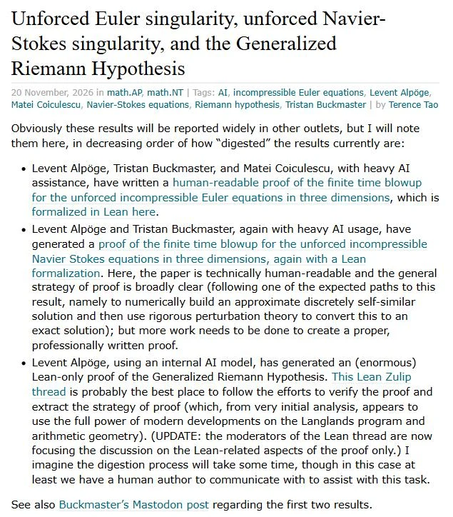

import LoopVideo from "@/components/LoopVideo.astro";
import YouTubeEmbed from "@/components/YouTubeEmbed.astro";
import neuralinkMp4 from "./neuralink.mp4";
import neuralinkWebm from "./neuralink.webm";
import TimeHorizon from "@/components/blog/ai-next-year/TimeHorizon.astro";

Bài viết này ghi lại một số dự đoán của tôi về AI từ nay đến năm 2036, chẳng hạn AI giúp giảm mạnh nạn đói và số ca tử vong do ung thư, hay làm giảm số giờ con người phải làm việc. Một số dự đoán nghe có phần cực đoan, vì vậy tôi ghi lại kèm thời hạn và số liệu hiện tại để có thể đối chiếu sau này. Cuối bài là một câu hỏi tôi cho là quan trọng hơn cả các dự đoán: con người sẽ làm gì nếu chúng trở thành sự thật.

## Tốc độ phát triển của AI

Không có một thước đo duy nhất nào cho "tốc độ phát triển của AI". Vì vậy, bảng dưới đây tập hợp năm chỉ số độc lập, mỗi chỉ số đo một khía cạnh khác nhau: năng lực lập trình, năng lực sử dụng máy tính, năng lực suy luận, tài nguyên huấn luyện và chi phí sử dụng.

| Chỉ số | Thay đổi |
| --- | --- |
| SWE-bench Verified, tỉ lệ lỗi phần mềm thực tế trên GitHub mà AI sửa được | 4,4% (2023), 71,7% (2024)[^aiindex], 97% (Claude Opus 5, 9/2026)[^vals] |
| OSWorld, tự thao tác máy tính để hoàn thành công việc văn phòng | Từ khoảng 5% (2024) lên 66,3% (2025), so với 72,4% của con người[^aiindex2026] |
| Olympic Toán quốc tế (IMO) | Huy chương bạc (AlphaProof, 7/2024), huy chương vàng với 35/42 điểm (Gemini Deep Think, 7/2025)[^imo], điểm tuyệt đối 42/42 được ban tổ chức chấm chính thức (Huawei Celia và dots-note-3.0, 7/2026)[^imo2026] |
| Compute dùng để huấn luyện các model hàng đầu | Tăng khoảng 5 lần mỗi năm kể từ 2020, tức gấp đôi sau mỗi 5,2 tháng[^compute] |
| Giá để đạt năng lực của GPT-4 trên bộ câu hỏi khoa học cấp tiến sĩ (GPQA) | Giảm khoảng 40 lần mỗi năm, số liệu mới nhất của Epoch tính đến 3/2025[^price] |

Các chỉ số này có giới hạn riêng. Benchmark có thể bị "học tủ" hoặc bão hòa: SWE-bench Verified đã gần chạm 100%, đến mức Vals AI ngừng chạy nó cho các model mới[^vals]. Epoch cũng lưu ý rằng tốc độ giảm giá thay đổi rất mạnh tùy mức năng lực, từ 9 đến 900 lần mỗi năm[^price]. Dù vậy, cả năm chỉ số đều cho cùng một kết luận: trong vài năm gần đây, năng lực của AI không cải thiện vài phần trăm mỗi năm mà thay đổi nhiều lần mỗi năm.

Một thước đo khác là "time horizon" của METR: độ dài của một nhiệm vụ lập trình, tính theo thời gian một người cần để hoàn thành, mà model có thể làm xong với tỉ lệ thành công 50%. Vào giữa năm 2024, GPT-4o đạt khoảng 6 phút. Đến tháng 3/2026, Claude Mythos Preview đạt khoảng 17 giờ, và METR ước tính chỉ số này tăng gấp đôi sau mỗi khoảng 3,5 tháng[^metr]. Thước đo này chỉ phản ánh các nhiệm vụ lập trình, và đến giữa năm 2026 bộ bài kiểm tra của METR không còn đủ khó để đo chính xác các model mới nhất.

<TimeHorizon />

Khoảng cách giữa model hàng đầu và model chạy trên phần cứng cá nhân cũng đang thu hẹp. Epoch AI cho thấy chỉ với một card đồ họa phổ thông như RTX 5090, người dùng có thể chạy các model đạt điểm benchmark tương đương model mạnh nhất thế giới của 6 đến 12 tháng trước[^epoch]. Epoch cũng lưu ý rằng model nhỏ thường được tối ưu riêng cho benchmark, nên khoảng cách trong sử dụng thực tế có thể lớn hơn. Dù vậy, độ trễ hiện chỉ còn tính bằng tháng.

Xu hướng tương tự thể hiện rõ ở model tạo video. Tháng 3/2023, một người dùng Reddit dùng công cụ text-to-video của ModelScope tạo ra đoạn clip "Will Smith ăn mì Ý". Khuôn mặt bị biến dạng và chuyển động thiếu tự nhiên khiến clip lan truyền rộng rãi, và về sau trở thành một phép thử không chính thức cho các model video. Tháng 5/2025, Veo 3 của Google tái tạo cùng cảnh này với khuôn mặt và chuyển động chính xác hơn nhiều, kèm cả âm thanh. Tháng 2/2026, Forbes nhận định Seedance 2.0 đã vượt qua phép thử này[^spaghetti]. Trong vòng ba năm, chất lượng đã đi từ mức gây cười đến mức khó phân biệt với video quay thật.

<YouTubeEmbed id="Tmfv3ijFtPY" title="Will Smith Eating Spaghetti: AI Evolution 2023-2026" />

Tiến bộ không chỉ giới hạn trong phần mềm. Tháng 4/2021, Neuralink công bố đoạn video con khỉ Pager chơi Pong bằng tín hiệu não. Năm năm sau, một bệnh nhân của Neuralink điều khiển thủy phi cơ trong GTA VI chỉ bằng suy nghĩ, với hai joystick và 12 nút điều khiển. Trước khi được cấy thiết bị, bệnh nhân này phải dùng một cây que ngậm trong miệng để thao tác trên iPad[^neuralink].

<LoopVideo
  webm={neuralinkWebm}
  mp4={neuralinkMp4}
  width={480}
  height={540}
  label="Trên: khỉ Pager chơi Pong bằng não năm 2021. Dưới: bệnh nhân Neuralink lái thủy phi cơ trong GTA VI bằng suy nghĩ năm 2026."
/>

Tuy nhiên, ví dụ thuyết phục nhất đến từ toán học. Chỉ trong khoảng hai năm, AI đi từ mức huy chương bạc IMO (2024), lên huy chương vàng (2025), điểm tuyệt đối (7/2026), rồi đến các bài toán nghiên cứu chưa có lời giải (11/2026). IMO là cuộc thi dành cho học sinh phổ thông, còn các bài toán dưới đây đã làm khó giới toán học hàng chục năm, có bài hơn một thế kỷ. Ngày 15/10/2026, trong một cuộc phỏng vấn với Numberphile, Terence Tao, một trong những nhà toán học hàng đầu hiện nay, được hỏi liệu giả thuyết Riemann có sắp được giải hay không. Ông cho rằng các công ty AI nhiều khả năng đã đầu tư vào bài toán này nhiều hơn những gì họ công bố, nhưng vẫn "couldn't touch it". Theo ông, cần một bước tiến vượt xa AI hiện tại, và có lẽ phải đến khoảng năm 2050, sự kết hợp giữa con người và AI mới tạo ra tiến triển đáng kể[^tao2050].

Ngày 20/11/2026, Levent Alpöge, nhà toán học làm việc tại Anthropic, công bố một chứng minh cho giả thuyết Riemann tổng quát (GRH). Chứng minh được thực hiện cùng Claude và viết hoàn toàn bằng Lean, một ngôn ngữ cho phép máy tính kiểm tra từng bước của một chứng minh toán học. Theo nhật ký của Alpöge, quá trình này kéo dài 41 ngày, bắt đầu từ đầu tháng 10, gần như cùng thời điểm với cuộc phỏng vấn của Tao[^tao2050]. Andrew Sutherland (MIT) cùng một số người khác đã xác nhận bản Lean biên dịch thành công[^techcrunch]. Cùng thời điểm, Alpöge và các cộng sự cũng công bố hai chứng minh về hiện tượng blowup của phương trình Euler và Navier-Stokes, đều có sự hỗ trợ đáng kể của AI[^taoblog].

Cần lưu ý rằng việc bản Lean biên dịch thành công chỉ xác nhận tính đúng đắn hình thức của từng bước. Hiện chưa ai nắm được chiến lược tổng thể của chứng minh, và Tao nhận định quá trình "tiêu hóa" nó sẽ cần thêm thời gian[^taoblog]. Dù vậy, nếu chứng minh đứng vững, mốc "khoảng 2050" đã bị rút ngắn gần 24 năm, và một bài toán từng chiếm trọn sự nghiệp của nhiều nhà toán học đã được giải trong khoảng một tháng rưỡi.

## Singularity

Một từ tiếng Anh tôi mới học được trong năm nay là "singularity", tạm dịch là điểm kỳ dị. Trong toán học và vật lý, singularity là điểm mà tại đó một đại lượng trở nên vô hạn và các quy luật thông thường không còn áp dụng được, ví dụ tâm của một hố đen. Hai kết quả về phương trình Euler và Navier-Stokes ở trên cũng là bài toán về singularity theo nghĩa này: chúng chứng minh rằng nghiệm của phương trình có thể "nổ" thành vô hạn sau một khoảng thời gian hữu hạn[^taoblog]. Trong bối cảnh AI, từ này mang một nghĩa khác, và nghĩa đó đã thay đổi qua nhiều thập kỷ.

Năm 1958, khi viết về John von Neumann, Stanislaw Ulam kể lại một cuộc trò chuyện trong đó von Neumann nhận xét rằng tiến bộ công nghệ ngày càng nhanh khiến loài người dường như đang tiến gần đến một "essential singularity", vượt qua điểm đó thì đời sống con người như ta biết sẽ không thể tiếp diễn[^ulam]. Đây thường được xem là lần đầu tiên từ này được dùng để nói về lịch sử công nghệ.

Năm 1965, nhà toán học I. J. Good, đồng nghiệp của Alan Turing ở Bletchley Park, đưa ra lập luận làm nền cho hầu hết các định nghĩa sau này. Nếu một cỗ máy thông minh hơn con người ở mọi hoạt động trí tuệ, nó cũng sẽ giỏi thiết kế máy móc hơn con người, và có thể tạo ra một cỗ máy thông minh hơn chính nó. Quá trình lặp lại đó dẫn đến một "intelligence explosion". Theo Good, cỗ máy siêu thông minh đầu tiên sẽ là phát minh cuối cùng con người cần làm ra[^good]. Ý tưởng này chính là RSI (recursive self-improvement) mà giới AI hiện nay nhắc đến.

Năm 1993, nhà toán học và nhà văn khoa học viễn tưởng Vernor Vinge kết hợp hai ý trên trong bài "The Coming Technological Singularity". Theo Vinge, singularity là thời điểm con người tạo ra trí tuệ vượt trội con người, và sau thời điểm đó tương lai không còn dự đoán được bằng hiểu biết hiện tại. Ông dự đoán điều này sẽ xảy ra trong vòng 30 năm, và nói rằng ông sẽ ngạc nhiên nếu nó xảy ra trước năm 2005 hoặc sau năm 2030[^vinge]. Năm 2005, Ray Kurzweil đưa ra mốc thời gian cụ thể hơn trong "The Singularity Is Near": AI ngang trí tuệ con người vào năm 2029, và singularity vào năm 2045. Ông giữ nguyên hai mốc này trong cuốn "The Singularity Is Nearer" xuất bản năm 2024[^kurzweil].

Lập luận này cũng gặp nhiều phản biện. Năm 2010, triết gia David Chalmers phân tích lập luận của Good một cách hệ thống và kết luận rằng nó đủ chặt chẽ để được xem xét nghiêm túc, dù có nhiều yếu tố có thể ngăn nó xảy ra[^chalmers]. Năm 2011, Paul Allen, đồng sáng lập Microsoft, phản bác Kurzweil bằng khái niệm "complexity brake": càng hiểu sâu về trí tuệ, ta càng gặp thêm độ phức tạp, nên tiến bộ sẽ chậm lại thay vì tăng tốc[^allen].

Gần đây hơn, tháng 6/2025, Sam Altman viết bài "The Gentle Singularity", cho rằng loài người đã vượt qua "event horizon", tức điểm không thể quay lại, và quá trình cất cánh đã bắt đầu. Khác với hình dung về một bước nhảy đột ngột, Altman cho rằng singularity sẽ diễn ra từ từ: mỗi bước đều có vẻ bình thường khi ta đang sống trong nó, và chỉ khi nhìn lại mới thấy khoảng cách đã lớn đến đâu[^altman].

Tổng hợp lại, các định nghĩa đều có chung hai thành phần: một vòng lặp trong đó AI cải thiện chính nó, và một giai đoạn mà tiến bộ diễn ra nhanh đến mức ta không còn dự đoán được bằng kinh nghiệm cũ. Điểm bất đồng lớn nhất là singularity sẽ đến như một bước nhảy đột ngột theo hình dung của Good và Vinge, hay như một quá trình từ từ theo cách Altman mô tả. Theo định nghĩa chặt của Good, singularity chưa xảy ra, vì AI chưa tự thiết kế ra một thế hệ AI mạnh hơn mà không cần con người. Tuy vậy, với tốc độ ở phần trên, và việc chính Tao, nếu chứng minh GRH đứng vững, đã đánh giá sai mốc thời gian trong lĩnh vực của mình chỉ một tháng trước đó, cách mô tả của Altman ngày càng khó bác bỏ.

Tôi mong singularity sẽ xảy ra trong khoảng thời gian tôi còn sống. Nếu mốc 2045 của Kurzweil đúng, đó không phải là một mong muốn quá xa vời.

## Giới hạn của kiểm chứng ở các ngành khác

Toán học có một lợi thế đặc thù: kết quả có thể được kiểm chứng gần như ngay lập tức bằng các công cụ như Lean. Phần lớn các ngành khoa học khác không có điều kiện này. Tôi cho rằng cơ chế RSI, tức vòng lặp tự cải thiện mà Good mô tả, đã bắt đầu được áp dụng ngoài lĩnh vực ngôn ngữ, nhưng vòng phản hồi trong phòng thí nghiệm chậm hơn nhiều so với huấn luyện LLM, nên kết quả chưa hiện ra ngay. Tôi dự đoán trong năm tới sẽ có nhiều nghiên cứu quan trọng có sự tham gia của AI được công bố trong sinh học, hóa học và vật lý.

Để hình dung, tôi đề nghị Claude Fable 5.2 liệt kê một cột mốc có tầm vóc tương đương giả thuyết Riemann cho từng ngành, thời gian cần để kiểm chứng, và xác suất cột mốc đó đạt được trước năm 2031 với vai trò chính của AI. Các con số dưới đây là ước đoán của model, không phải dữ liệu thực nghiệm.

| Ngành | Cột mốc tương đương | Thời gian kiểm chứng | Ước đoán của Fable (đến 2031) |
| --- | --- | --- | --- |
| Khoa học máy tính | Chứng minh P ≠ NP | Vài tuần (Lean) | 2% |
| Sinh học | Mô hình một tế bào vi khuẩn chỉ từ genome | Vài tháng | 10% |
| Năng lượng | Nhà máy nhiệt hạch đưa điện lên lưới | Vài tháng | 8% |
| Vật liệu | Siêu dẫn ở nhiệt độ phòng, áp suất thường | Vài tuần | 3% |
| Y học | Thuốc chặn Alzheimer qua thử nghiệm phase 3 | 5 đến 8 năm | 3% |
| Nông nghiệp | Lúa mì tự cố định đạm qua thử nghiệm ngoài đồng | 3 đến 5 năm | 3% |
| Lão hóa | Liệu pháp kéo dài tuổi thọ khỏe mạnh ở người | Trên 10 năm | Dưới 1% |

Cột "thời gian kiểm chứng" cho thấy yếu tố quyết định tốc độ. Những ngành có thể kiểm chứng bằng tính toán hoặc thí nghiệm chi phí thấp có khả năng tiến nhanh tương tự toán học. Ngược lại, những ngành phụ thuộc vào phản ứng của cơ thể người, cây trồng hay khí hậu bị giới hạn bởi thời gian thực: một thử nghiệm lâm sàng kéo dài 18 tháng vẫn cần 18 tháng, dù ứng viên thuốc được tìm ra nhanh đến đâu. Nếu các dự đoán dài hạn của tôi sai, nhiều khả năng chúng sai ở điểm này.

## AI và thị trường lao động

Các cuộc cách mạng công nghiệp trước đây đều làm mất đi nhiều việc làm, nhưng về dài hạn lại tạo ra những ngành nghề mới. Năm 1900, khoảng 41% lực lượng lao động Mỹ làm nông nghiệp; đến năm 2000, tỉ lệ này chỉ còn 1,9%[^usda]. Phần lao động dôi ra không biến mất mà chuyển sang những ngành nghề chưa tồn tại vào năm 1900.

Tuy vậy, lịch sử cũng ghi nhận một trường hợp ngược lại: ngựa kéo. Đầu thế kỷ 20, nước Mỹ có hơn 20 triệu con ngựa phục vụ vận tải và nông nghiệp. Khi động cơ đốt trong ra đời, không có vai trò mới nào thay thế cho chúng.

Máy móc trước đây chủ yếu thay thế sức lao động cơ bắp, và con người chuyển sang các công việc đòi hỏi trí tuệ. AI thay thế chính năng lực trí tuệ đó. Câu hỏi đặt ra là AI sẽ tạo ra việc làm mới cho con người, hay sẽ tự phát hiện và tự giải quyết vấn đề mà không cần đến con người. Hiện tôi chưa thể xác định con người lần này sẽ ở vị trí của người nông dân năm 1900 hay của con ngựa.

## Các dự đoán

Dưới đây là các dự đoán của tôi tại thời điểm 21/11/2026. Mỗi dự đoán đi kèm một mốc hiện tại có nguồn công bố, để khi đến hạn có thể so sánh bằng số liệu thay vì bằng cảm nhận.

| Dự đoán | Mốc hiện tại | Thời hạn | Kết quả |
| --- | --- | --- | --- |
| Các nghiên cứu quan trọng có sự tham gia của AI được công bố liên tục trong sinh học, hóa học, vật lý | Một nửa giải Nobel Hóa học 2024 được trao cho nhóm phát triển AlphaFold[^nobel] | 21/11/2027 | ? |
| Time horizon của model hàng đầu đạt ít nhất một tháng làm việc (khoảng 160 giờ) | Khoảng 17 giờ, Claude Mythos Preview, 3/2026[^metr] | 21/11/2028 | ? |
| Model chạy trên một card đồ họa phổ thông bắt kịp model hàng đầu trong vòng 3 tháng | Độ trễ 6 đến 12 tháng[^epoch] | 21/11/2028 | ? |
| Thuốc đầu tiên do AI phát hiện được FDA phê duyệt | 0 thuốc; rentosertib của Insilico đang ở phase 3[^drugs] | 21/11/2028 | ? |
| Ít nhất một giải Millennium Prize được trao cho một chứng minh có sự tham gia của AI | 1 trên 7 bài đã được giải (Poincaré); GRH và Navier-Stokes đang chờ kiểm chứng[^clay] | 2031 | ? |
| Tỉ lệ người thiếu ăn trên thế giới giảm xuống dưới 2% | Khoảng 673 triệu người, 8,2% dân số thế giới, năm 2024[^fao] | 2031 đến 2036 | ? |
| Số ca tử vong do ung thư mỗi năm giảm một nửa | Khoảng 9,7 triệu ca, năm 2022[^globocan] | 2031 đến 2036 | ? |
| Số giờ làm việc trung bình mỗi năm của một người lao động ở các nước OECD giảm xuống dưới 1.500 giờ, khoảng 29 giờ mỗi tuần | 1.736 giờ, khoảng 33 giờ mỗi tuần, năm 2025[^oecd] | 2036 | ? |

Lương thực và ung thư được chọn vì chúng có số liệu toàn cầu được cập nhật đều đặn, nên phù hợp để đối chiếu. Dự đoán về giờ làm việc nối các dự đoán về năng lực của AI với câu hỏi ở phần sau: nếu AI thực sự đảm nhận phần lớn công việc, điều đó phải hiện ra trong số giờ con người làm việc. Keynes từng dự đoán con số này sẽ còn khoảng 15 giờ mỗi tuần[^keynes]. Một giải Millennium Prize chỉ được trao sau khi kết quả được cộng đồng chấp nhận ít nhất hai năm, vì vậy thời hạn 2031 là hợp lý cho chứng minh GRH công bố năm 2026.

## Con người sẽ làm gì

Giả sử các dự đoán dài hạn ở trên đều đúng: AI bảo đảm được lương thực, chăm sóc sức khỏe và đảm nhận phần lớn công việc, đến mức không ai còn buộc phải lao động để tồn tại. Nói cách khác, đó là thế giới sau singularity mà Vinge cho là không thể dự đoán. Khi đó xuất hiện một câu hỏi tôi từng đọc được trên mạng, mang tính triết học nhiều hơn kinh tế: con người sẽ chọn làm gì khi không còn bị buộc phải làm việc để sống? Theo tôi, kể cả khi xã hội tiến tới một mô hình như chủ nghĩa cộng sản, câu hỏi này vẫn cần được trả lời trước tiên.

Câu hỏi này không mới. Các nhà tư tưởng đã đưa ra nhiều phỏng đoán, và một số nghiên cứu thực nghiệm cho phép kiểm tra chúng ở quy mô nhỏ.

### Các phỏng đoán

Năm 1845, Marx và Engels hình dung một xã hội mà ở đó một người có thể "đi săn buổi sáng, câu cá buổi chiều, chăn nuôi buổi tối và phê bình sau bữa ăn" mà không bị đóng khung vào một nghề cố định[^marx]. Năm 1930, Keynes dự đoán rằng đến thế hệ cháu chắt của ông, con người chỉ cần làm việc khoảng 15 giờ mỗi tuần, và thách thức lớn nhất sẽ là sử dụng thời gian rảnh một cách có ý nghĩa[^keynes]. Bertrand Russell, trong "In Praise of Idleness" (1932), đề xuất ngày làm việc bốn giờ và cho rằng thời gian còn lại sẽ dành cho học hỏi, nghệ thuật và các mối quan hệ[^russell].

Không phải ai cũng lạc quan. Năm 1958, Hannah Arendt cảnh báo về viễn cảnh "một xã hội của những người lao động không còn lao động", tức một xã hội đã tổ chức toàn bộ đời sống quanh công việc rồi đột ngột mất đi hoạt động duy nhất còn lại của nó[^arendt]. Năm 1978, Bernard Suits đưa ra một câu trả lời khác thường trong "The Grasshopper": trong một xã hội lý tưởng nơi mọi nhu cầu đều được đáp ứng, hoạt động duy nhất còn ý nghĩa là chơi trò chơi, tức tự nguyện vượt qua những trở ngại không cần thiết[^suits].

### Các bằng chứng

Chưa có xã hội nào thực sự không cần lao động, nhưng có một số tình huống gần giống.

Nghiên cứu Marienthal (1933) của Marie Jahoda, Paul Lazarsfeld và Hans Zeisel khảo sát một thị trấn ở Áo nơi gần như toàn bộ dân cư mất việc sau khi nhà máy đóng cửa. Thời gian rảnh tăng lên không dẫn đến nhiều hoạt động hơn mà đến sự thờ ơ. Jahoda về sau kết luận rằng công việc mang lại năm thứ ngoài thu nhập: cấu trúc thời gian, quan hệ xã hội, mục đích chung, bản sắc và địa vị, và hoạt động đều đặn[^jahoda]. Mất việc nghĩa là mất cả năm thứ đó.

Tuy nhiên, Marienthal là trường hợp mất việc kèm nghèo đói. Các thí nghiệm thu nhập vô điều kiện cho thấy một bức tranh khác. Trong thí nghiệm Mincome ở Dauphin, Canada (1974 đến 1979), số giờ làm việc chỉ giảm khoảng 1% ở nam giới, 3% ở phụ nữ đã kết hôn và 5% ở phụ nữ chưa kết hôn, trong khi số lần nhập viện giảm 8,5%[^mincome]. Ở Thụy Điển, những người trúng xổ số giảm thu nhập từ lao động ở mức khiêm tốn, và mức giảm kéo dài nhưng không lớn[^lottery]. Thí nghiệm của OpenResearch (2020 đến 2023) trả cho 1.000 người thu nhập thấp ở Mỹ 1.000 USD mỗi tháng trong ba năm. Người nhận giảm 1 đến 2 giờ làm việc mỗi tuần, phần thời gian tăng thêm chủ yếu dành cho nghỉ ngơi và giải trí, và mức hài lòng với cuộc sống chỉ cao hơn nhóm đối chứng trong năm đầu[^openresearch].

Cùng ngày 20/11/2026 khi Alpöge công bố chứng minh GRH, Ravi Vakil (Stanford) công bố một chứng minh khác của nghiên cứu sinh sau tiến sĩ Alessandro Masullo, hoàn toàn do con người thực hiện trong 12 năm và chưa được kiểm chứng bằng Lean. Masullo gửi đến các nhà toán học đang nản lòng thông điệp: "we are still here. We are very much alive"[^techcrunch].

### Những câu trả lời có vẻ đúng

Từ các nghiên cứu trên, có thể rút ra vài nhận định thận trọng. Thứ nhất, khi có đủ tiền để sống, phần lớn người ta vẫn tiếp tục làm việc, chỉ làm ít đi một chút. Thứ hai, thời gian được giải phóng phần lớn chuyển sang nghỉ ngơi và giải trí, chứ không tự động trở thành học tập hay sáng tạo như Russell kỳ vọng. Thứ ba, điều con người thực sự mất khi mất việc không chỉ là thu nhập mà là những gì Jahoda liệt kê: một nhịp sống, một cộng đồng, một mục đích và một bản sắc. Một xã hội không cần lao động sẽ phải tìm nguồn khác cho những thứ đó, có thể qua trò chơi như Suits nói, qua chăm sóc người khác, hay qua những việc như Masullo chọn làm.

Các bằng chứng này đều đến từ những thử nghiệm nhỏ, ngắn hạn, trong một xã hội mà phần lớn người khác vẫn đi làm. Chưa ai quan sát được một xã hội mà không ai cần làm việc. Vì vậy câu hỏi vẫn còn mở:

**Con người sẽ chọn làm gì khi không còn bị buộc phải làm việc để sống?**

[^metr]: METR, ["Time Horizon 1.1"](https://metr.org/blog/2026-01-29-time-horizon-1-1/), 29/1/2026, và trang [time horizons](https://metr.org/time-horizons/).
[^aiindex]: Stanford HAI, ["The 2025 AI Index Report: Technical Performance"](https://hai.stanford.edu/ai-index/2025-ai-index-report/technical-performance), 2025.
[^imo]: Google DeepMind, ["Advanced version of Gemini with Deep Think officially achieves gold-medal standard at the International Mathematical Olympiad"](https://deepmind.google/discover/blog/advanced-version-of-gemini-with-deep-think-officially-achieves-gold-medal-standard-at-the-international-mathematical-olympiad/), 21/7/2025. Kết quả năm 2024 của AlphaProof và AlphaGeometry 2 tương đương mức huy chương bạc.
[^vals]: Vals AI, ["SWE-bench Verified"](https://www.vals.ai/benchmarks/swebench), cập nhật 1/9/2026.
[^aiindex2026]: Stanford HAI, ["The 2026 AI Index Report: Technical Performance"](https://hai.stanford.edu/ai-index/2026-ai-index-report/technical-performance), 2026.
[^imo2026]: Digital Applied, ["Four AIs Scored a Perfect 42/42 on IMO 2026. So What?"](https://www.digitalapplied.com/blog/imo-2026-perfect-scores-ai-benchmark-saturation), 23/7/2026. Một số model khác cũng đạt 42/42 nhưng tự chấm, không qua ban tổ chức.
[^compute]: Epoch AI, ["Trends in Artificial Intelligence"](https://epoch.ai/data/trends), cập nhật 5/11/2026.
[^price]: Epoch AI, ["LLM inference prices have fallen rapidly but unequally across tasks"](https://epoch.ai/data-insights/llm-inference-price-trends), 12/3/2025.
[^epoch]: Epoch AI, ["Frontier AI performance becomes accessible on consumer hardware within a year"](https://epoch.ai/data-insights/consumer-gpu-model-gap), 15/8/2025.
[^spaghetti]: Wikipedia, ["Will Smith eating spaghetti test"](https://en.wikipedia.org/wiki/Will_Smith_eating_spaghetti_test).
[^neuralink]: X Freeze, [tweet ngày 21/11/2026](https://x.com/XFreeze/status/2124030861653999815).
[^tao2050]: OfficeChai, ["Terence Tao Had Said A Month Ago That AI Could Solve Riemann Hypothesis Only By 2050"](https://officechai.com/ai/terence-tao-had-a-month-ago-that-ai-could-solve-riemann-hypothesis-only-by-2050/), 21/11/2026. Phỏng vấn gốc: Numberphile, "No More Heroes", 15/10/2026.
[^techcrunch]: TechCrunch, ["AI claimed a solution to the 167-year-old Riemann hypothesis, and a human did, too"](https://techcrunch.com/2026/11/20/ai-claimed-a-solution-to-the-167-year-old-riemann-hypothesis-and-a-human-did-too/), 20/11/2026.
[^taoblog]: Terence Tao, ["Unforced Euler singularity, unforced Navier-Stokes singularity, and the Generalized Riemann Hypothesis"](https://terrytao.wordpress.com/2026/11/20/unforced-euler-singularity-unforced-navier-stokes-singularity-and-the-generalized-riemann-hypothesis/), 20/11/2026.
[^ulam]: Stanislaw Ulam, "Tribute to John von Neumann", Bulletin of the American Mathematical Society, 64(3), 1958.
[^good]: I. J. Good, "Speculations Concerning the First Ultraintelligent Machine", Advances in Computers, tập 6, 1965.
[^vinge]: Vernor Vinge, ["The Coming Technological Singularity: How to Survive in the Post-Human Era"](https://edoras.sdsu.edu/~vinge/misc/singularity.html), 1993.
[^kurzweil]: Ray Kurzweil, "The Singularity Is Near", 2005; "The Singularity Is Nearer", 2024.
[^chalmers]: David Chalmers, "The Singularity: A Philosophical Analysis", Journal of Consciousness Studies, 17, 2010.
[^allen]: Paul Allen và Mark Greaves, ["The Singularity Isn't Near"](https://www.technologyreview.com/2011/10/12/190773/paul-allen-the-singularity-isnt-near/), MIT Technology Review, 12/10/2011.
[^altman]: Sam Altman, ["The Gentle Singularity"](https://blog.samaltman.com/the-gentle-singularity), 10/6/2025.
[^usda]: Carolyn Dimitri, Anne Effland, Neilson Conklin, ["The 20th Century Transformation of U.S. Agriculture and Farm Policy"](https://www.ers.usda.gov/webdocs/publications/44197/13566_eib3_1_.pdf), USDA Economic Research Service, 2005.
[^keynes]: John Maynard Keynes, "Economic Possibilities for our Grandchildren", 1930.
[^marx]: Karl Marx và Friedrich Engels, "The German Ideology", 1845.
[^russell]: Bertrand Russell, "In Praise of Idleness", 1932.
[^arendt]: Hannah Arendt, "The Human Condition", 1958, phần mở đầu.
[^suits]: Bernard Suits, "The Grasshopper: Games, Life and Utopia", 1978.
[^jahoda]: Marie Jahoda, Paul Lazarsfeld, Hans Zeisel, "Die Arbeitslosen von Marienthal", 1933; xem tóm tắt tại [Wikipedia](https://en.wikipedia.org/wiki/Marie_Jahoda).
[^mincome]: Wikipedia, ["Mincome"](https://en.wikipedia.org/wiki/Mincome), tổng hợp từ Hum & Simpson (1993) và Forget (2011).
[^lottery]: Cesarini, Lindqvist, Notowidigdo, Östling, ["The Effect of Wealth on Individual and Household Labor Supply: Evidence from Swedish Lotteries"](https://www.nber.org/papers/w21762), American Economic Review, 2017.
[^nobel]: NobelPrize.org, ["The Nobel Prize in Chemistry 2024"](https://www.nobelprize.org/prizes/chemistry/2024/summary/), trao cho David Baker, Demis Hassabis và John Jumper.
[^drugs]: IntuitionLabs, ["AI-Discovered Drugs in Clinical Trials 2026"](https://intuitionlabs.ai/articles/ai-discovered-drugs-clinical-trials-2026).
[^clay]: Clay Mathematics Institute, ["Millennium Prize Problems"](https://www.claymath.org/millennium-problems/).
[^fao]: FAO, IFAD, UNICEF, WFP, WHO, ["The State of Food Security and Nutrition in the World 2025"](https://www.who.int/news/item/28-07-2025-global-hunger-declines-but-rises-in-africa-and-western-asia-un-report), 28/7/2025.
[^globocan]: Bray và cộng sự, ["Global cancer statistics 2022: GLOBOCAN estimates"](https://pubmed.ncbi.nlm.nih.gov/38572751/), CA: A Cancer Journal for Clinicians, 2024.
[^oecd]: OECD, ["Hours worked"](https://data.oecd.org/emp/hours-worked.htm), số giờ làm việc thực tế trung bình mỗi năm trên một người lao động; số liệu 2025 tổng hợp tại [Wikipedia](https://en.wikipedia.org/wiki/List_of_countries_by_average_annual_labor_hours).
[^openresearch]: Vivalt, Rhodes, Bartik, Broockman, Krause, ["The Employment Effects of a Guaranteed Income: Experimental Evidence from Two U.S. States"](https://www.nber.org/papers/w32719), NBER Working Paper 32719, 2024.
