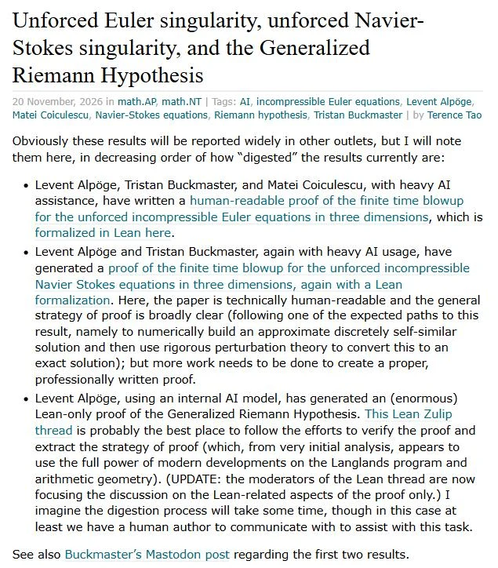

import LoopVideo from "@/components/LoopVideo.astro";
import YouTubeEmbed from "@/components/YouTubeEmbed.astro";
import neuralinkMp4 from "./neuralink.mp4";
import neuralinkWebm from "./neuralink.webm";
import TimeHorizon from "@/components/blog/ai-next-year/TimeHorizon.astro";

Tôi có một dự đoán hơi liều: trong 5 đến 10 năm nữa, AI sẽ giải quyết được khoảng 90% vấn đề lớn của con người, từ chuyện làm ra đủ lương thực cho tới chữa những bệnh như ung thư.

Nghe thì giống người đang say AI. Nên tôi ghi lại ở đây, có ngày tháng rõ ràng, để sau này mở ra xem mình đúng hay sai. Bài này là những thứ khiến tôi nghĩ vậy, chỗ tôi thấy mình có thể sai, và một câu hỏi tôi thấy rất đáng suy nghĩ.

## AI đang nhanh tới mức nào

METR có một cách đo khá dễ hiểu. Họ đưa cho model một việc lập trình, rồi xem việc dài nhất mà nó làm xong được một nửa số lần là bao lâu, tính theo thời gian một người làm.

Giữa năm 2024, GPT-4o làm được việc dài khoảng 6 phút. Tháng 2/2026, Claude Opus 4.6 làm được việc dài khoảng 12 tiếng. Con số này cứ khoảng 3,5 tháng lại gấp đôi[^metr]. Tới giữa năm nay, METR không còn bài nào đủ khó để đo tiếp.

<TimeHorizon />

Model chạy ở nhà cũng đuổi theo rất sát. Theo Epoch AI, chỉ cần một card chơi game như RTX 5090 là bạn chạy được model có điểm benchmark ngang model mạnh nhất thế giới của 6 đến 12 tháng trước[^epoch]. Dùng thật thì có thể kém hơn một chút, vì model nhỏ hay được tối ưu cho benchmark. Nhưng khoảng cách giờ chỉ còn tính bằng tháng.

Video thì dễ thấy hơn nữa. Tháng 3/2023, có người trên Reddit dùng ModelScope làm một clip Will Smith ăn mì Ý. Mặt méo mó, mì bay lung tung, nhìn đáng sợ tới mức clip thành meme, rồi thành luôn một bài test không chính thức cho model video.

Tháng 5/2025, Veo 3 của Google làm lại đúng cảnh đó, mặt ra mặt, có cả tiếng nhai. Tháng 2/2026, Forbes viết rằng Seedance 2.0 đã qua bài test này[^spaghetti]. Chỉ ba năm, từ một clip để cười thành thứ khó phân biệt với video thật.

<YouTubeEmbed id="Tmfv3ijFtPY" title="Will Smith Eating Spaghetti: AI Evolution 2023-2026" />

Ngoài màn hình cũng vậy. Tháng 4/2021, Neuralink cho xem con khỉ Pager chơi Pong bằng não. Năm năm sau, một bệnh nhân của họ lái thủy phi cơ trong GTA VI chỉ bằng suy nghĩ, điều khiển cùng lúc hai joystick và 12 nút. Trước khi gắn chip, anh ấy phải ngậm một cây que trong miệng để bấm iPad[^neuralink].

<LoopVideo
  webm={neuralinkWebm}
  mp4={neuralinkMp4}
  width={480}
  height={540}
  label="Trên: khỉ Pager chơi Pong bằng não năm 2021. Dưới: bệnh nhân Neuralink lái thủy phi cơ trong GTA VI bằng suy nghĩ năm 2026."
/>

## Riemann

Nhưng chuyện làm tôi bất ngờ nhất là toán.

Ngày 15/10, Terence Tao, một trong những nhà toán học giỏi nhất còn sống, được Numberphile hỏi giả thuyết Riemann có sắp được giải không. Ông nói các công ty AI chắc đã dồn sức vào nó nhiều hơn họ công bố, nhưng vẫn "couldn't touch it". Theo ông, có lẽ phải tới khoảng năm 2050, người và AI cùng làm, mới tiến thêm được[^tao2050].

Ngày 20/11, Levent Alpöge, một nhà toán học làm ở Anthropic, đăng chứng minh cho giả thuyết Riemann tổng quát (GRH). Anh làm cùng Claude, và toàn bộ chứng minh được viết bằng Lean, một ngôn ngữ để máy kiểm tra chứng minh toán từng bước.

Theo log của anh, cả quá trình mất 41 ngày, bắt đầu từ đầu tháng 10, gần như đúng tuần Tao trả lời phỏng vấn[^tao2050]. Andrew Sutherland ở MIT và vài người khác đã xác nhận bản Lean compile được[^techcrunch]. Cùng lúc đó, Alpöge và các cộng sự còn đăng thêm hai chứng minh cho phương trình Euler và Navier-Stokes, cũng nhờ AI rất nhiều[^taoblog].

Compile được thì mới chỉ có nghĩa là máy thấy từng bước đều đúng. Chưa ai hiểu chứng minh đi theo hướng nào, và Tao nói sẽ cần thời gian để "tiêu hóa" nó[^taoblog].

Dù vậy, nếu chứng minh này đứng vững, mốc "khoảng 2050" đã sai gần 24 năm. Có người dành cả đời cho một bài toán. Lần này, một nhà toán học và một model làm xong trong khoảng một tháng rưỡi.

## Toán nhanh, mấy ngành khác thì chưa chắc

Toán có một lợi thế lớn: kiểm tra đúng sai gần như ngay lập tức. Lean chạy xong là biết.

Mấy ngành khác không được vậy. Tôi nghĩ RSI (recursive self-improvement, AI tự cải thiện chính nó) đã được đem ra dùng ngoài đời rồi. Chỉ là vòng feedback trong phòng thí nghiệm chậm hơn LLM nhiều, nên mình chưa thấy ngay. Tôi đoán qua năm sau sẽ thấy nghiên cứu có AI được công bố liên tục, từ sinh học, hóa học tới vật lý.

Tôi hỏi thử Claude Fable 5.2: mỗi ngành có "Riemann" nào, tức một tin lớn cỡ đó, kiểm chứng mất bao lâu, và khả năng có trước 2031 nếu AI làm phần lớn. Các con số dưới đây là model đoán, không phải dữ liệu.

| Ngành | Tin "ngang Riemann" | Kiểm chứng mất | Fable đoán tới 2031 |
| --- | --- | --- | --- |
| Khoa học máy tính | Chứng minh P ≠ NP | Vài tuần (Lean) | 2% |
| Sinh học | Mô hình một tế bào vi khuẩn chỉ từ genome | Vài tháng | 10% |
| Năng lượng | Nhà máy nhiệt hạch đưa điện lên lưới | Vài tháng | 8% |
| Vật liệu | Siêu dẫn ở nhiệt độ phòng, áp suất thường | Vài tuần | 3% |
| Y học | Thuốc chặn Alzheimer qua thử nghiệm phase 3 | 5 đến 8 năm | 3% |
| Nông nghiệp | Lúa mì tự cố định đạm qua thử nghiệm ngoài đồng | 3 đến 5 năm | 3% |
| Lão hóa | Liệu pháp kéo dài tuổi thọ khỏe mạnh ở người | Trên 10 năm | Dưới 1% |

Cột tôi thấy quan trọng nhất là "kiểm chứng mất". Ngành nào kiểm được bằng máy tính hay thí nghiệm rẻ thì có thể chạy nhanh như toán. Ngành nào phải chờ cơ thể người, cây trồng hay khí hậu thì kẹt ở thời gian.

Một thử nghiệm thuốc kéo dài 18 tháng thì vẫn mất 18 tháng, dù AI tìm ra thuốc nhanh cỡ nào. Nếu dự đoán 90% của tôi sai, chắc nó sai ở chỗ này.

## Lần này có việc mới không

Mỗi cuộc cách mạng công nghiệp đều làm nhiều người mất việc, rồi cuối cùng lại tạo ra việc mới. Năm 1900, khoảng 40% lao động Mỹ làm nông. Bây giờ chưa tới 2%. Số người đó không ngồi không, họ chuyển sang những nghề hồi 1900 chưa ai nghĩ ra.

Nhưng có một nhóm đã không chuyển nghề được: con ngựa. Đầu thế kỷ 20, Mỹ có hơn 20 triệu con ngựa kéo xe, cày ruộng. Động cơ đốt trong ra đời, và không có nghề mới nào cho ngựa cả.

Máy móc trước đây thay phần cơ bắp, nên con người chuyển qua dùng đầu óc. Lần này AI thay luôn phần đầu óc. Nó sẽ tạo ra việc mới cho con người, hay tự tìm ra vấn đề rồi tự giải luôn?

Tôi chưa biết lần này mình sẽ là người nông dân năm 1900, hay là con ngựa.

## Các dự đoán

Đây là những gì tôi đoán hôm nay, 21/11/2026.

| Dự đoán | Hạn | Kết quả |
| --- | --- | --- |
| Nghiên cứu lớn có AI được công bố liên tục trong sinh học, hóa học, vật lý | 21/11/2027 | ? |
| AI giải quyết được khoảng 90% vấn đề lớn của con người, ví dụ lương thực, bệnh tật | 2031 đến 2036 | ? |

## Con người sẽ làm gì

Giả sử dự đoán thứ hai đúng. AI lo được đồ ăn, bệnh tật và phần lớn công việc. Không ai còn phải đi làm để sống nữa.

Tôi từng đọc được một câu hỏi trên mạng: con người sẽ chọn làm gì khi không còn bị buộc phải làm việc để sống? Với tôi, kể cả có tiến tới cộng sản đi nữa thì cũng phải trả lời được câu này trước đã.

Câu hỏi này không mới. Người ta đã đoán nhiều lần, và cũng có vài nghiên cứu cho mình nhìn thử.

### Người ta từng đoán gì

Năm 1845, Marx và Engels tưởng tượng một xã hội mà ở đó bạn có thể "đi săn buổi sáng, câu cá buổi chiều, chăn nuôi buổi tối, và phê bình sau bữa ăn", không cần gắn cả đời với một nghề[^marx].

Năm 1930, Keynes đoán tới đời cháu chắt ông, người ta chỉ cần làm khoảng 15 tiếng một tuần. Cái khó nhất lúc đó sẽ là sống sao cho đáng với thời gian rảnh[^keynes]. Hai năm sau, Bertrand Russell viết "In Praise of Idleness", đề xuất mỗi ngày chỉ làm 4 tiếng và dành phần còn lại cho học hỏi, nghệ thuật, bạn bè[^russell].

Có người thì lo. Năm 1958, Hannah Arendt cảnh báo về "một xã hội của những người lao động không còn lao động": một xã hội đã xây cả đời sống quanh công việc, rồi bỗng dưng mất luôn thứ duy nhất nó biết làm[^arendt].

Một câu trả lời khá lạ là của Bernard Suits trong "The Grasshopper" (1978). Ông cho rằng trong một xã hội lý tưởng, khi mọi nhu cầu đều được lo xong, thứ duy nhất còn đáng làm là chơi trò chơi, tức là tự nguyện vượt qua những thử thách không cần thiết[^suits]. Nghe thì buồn cười, nhưng nghĩ lại thì leo núi, chơi cờ, giải toán cho vui đều là vậy.

### Thực tế cho thấy gì

Chưa có xã hội nào thực sự không cần ai làm việc. Nhưng có vài trường hợp gần giống.

Năm 1933, Marie Jahoda và các cộng sự nghiên cứu Marienthal, một thị trấn ở Áo mà gần như cả thị trấn mất việc sau khi nhà máy đóng cửa. Có nhiều thời gian rảnh hơn, nhưng người ta không làm nhiều thứ hơn. Họ trở nên thờ ơ. Jahoda về sau kết luận rằng ngoài tiền lương, công việc còn cho con người năm thứ: nhịp sinh hoạt mỗi ngày, quan hệ xã hội, mục đích chung, bản sắc, và việc để làm đều đặn[^jahoda]. Mất việc là mất cả năm thứ đó.

Có điều Marienthal là mất việc kèm nghèo đói. Khi người ta được cho tiền mà không phải làm gì, kết quả khác hẳn:

- Mincome ở Dauphin, Canada (1974 đến 1979): giờ làm chỉ giảm khoảng 1% ở nam giới, 3% ở phụ nữ đã kết hôn, 5% ở phụ nữ chưa kết hôn. Số lần nhập viện giảm 8,5%[^mincome].
- Người trúng xổ số ở Thụy Điển: thu nhập từ đi làm giảm, nhưng giảm không nhiều[^lottery].
- OpenResearch ở Mỹ (2020 đến 2023): 1.000 người thu nhập thấp nhận 1.000 USD mỗi tháng trong ba năm. Họ làm ít đi 1 đến 2 tiếng mỗi tuần, thời gian dư chủ yếu dành để nghỉ ngơi và giải trí. Họ thấy hạnh phúc hơn trong năm đầu, rồi trở lại như nhóm không nhận tiền[^openresearch].

Và còn Alessandro Masullo. Cùng ngày Alpöge đăng chứng minh, Ravi Vakil ở Stanford đăng một chứng minh GRH khác của Masullo, một postdoc. Chứng minh này viết hoàn toàn bằng tay, không dùng AI, mất 12 năm, và chưa có bản Lean nên chưa ai biết đúng sai. Masullo gửi lời tới những nhà toán học đang nản: "we are still here. We are very much alive"[^techcrunch].

### Vậy câu trả lời có thể là gì

Từ những gì ở trên, tôi rút ra được vài điều.

Có đủ tiền để sống thì phần lớn người ta vẫn đi làm, chỉ làm ít đi một chút. Thời gian rảnh có thêm thì chủ yếu để nghỉ ngơi, chứ không tự nhiên biến thành học hành hay sáng tạo như Russell mong. Còn thứ người ta thật sự mất khi không còn đi làm không phải tiền, mà là những thứ Jahoda liệt kê: nhịp sống, cộng đồng, mục đích, và cảm giác mình là ai.

Nếu một ngày không ai cần đi làm nữa, có lẽ mình phải tìm những thứ đó ở chỗ khác. Có thể là trò chơi như Suits nói, là chăm sóc người khác, hay là theo đuổi một bài toán suốt 12 năm như Masullo.

Nhưng tất cả những nghiên cứu này đều nhỏ, ngắn, và diễn ra trong một xã hội mà những người khác vẫn đi làm. Chưa ai từng thấy một thế giới mà không ai cần làm việc. Nên câu hỏi vẫn còn đó:

**Con người sẽ chọn làm gì khi không còn bị buộc phải làm việc để sống?**

[^metr]: METR, ["Time Horizon 1.1"](https://metr.org/blog/2026-01-29-time-horizon-1-1/), 29/1/2026, và trang [time horizons](https://metr.org/time-horizons/).
[^epoch]: Epoch AI, ["Frontier AI performance becomes accessible on consumer hardware within a year"](https://epoch.ai/data-insights/consumer-gpu-model-gap), 15/8/2025.
[^spaghetti]: Wikipedia, ["Will Smith eating spaghetti test"](https://en.wikipedia.org/wiki/Will_Smith_eating_spaghetti_test).
[^neuralink]: X Freeze, [tweet ngày 21/11/2026](https://x.com/XFreeze/status/2124030861653999815).
[^tao2050]: OfficeChai, ["Terence Tao Had Said A Month Ago That AI Could Solve Riemann Hypothesis Only By 2050"](https://officechai.com/ai/terence-tao-had-a-month-ago-that-ai-could-solve-riemann-hypothesis-only-by-2050/), 21/11/2026. Phỏng vấn gốc: Numberphile, "No More Heroes", 15/10/2026.
[^techcrunch]: TechCrunch, ["AI claimed a solution to the 167-year-old Riemann hypothesis, and a human did, too"](https://techcrunch.com/2026/11/20/ai-claimed-a-solution-to-the-167-year-old-riemann-hypothesis-and-a-human-did-too/), 20/11/2026.
[^taoblog]: Terence Tao, ["Unforced Euler singularity, unforced Navier-Stokes singularity, and the Generalized Riemann Hypothesis"](https://terrytao.wordpress.com/2026/11/20/unforced-euler-singularity-unforced-navier-stokes-singularity-and-the-generalized-riemann-hypothesis/), 20/11/2026.
[^keynes]: John Maynard Keynes, "Economic Possibilities for our Grandchildren", 1930.
[^marx]: Karl Marx và Friedrich Engels, "The German Ideology", 1845.
[^russell]: Bertrand Russell, "In Praise of Idleness", 1932.
[^arendt]: Hannah Arendt, "The Human Condition", 1958, phần mở đầu.
[^suits]: Bernard Suits, "The Grasshopper: Games, Life and Utopia", 1978.
[^jahoda]: Marie Jahoda, Paul Lazarsfeld, Hans Zeisel, "Die Arbeitslosen von Marienthal", 1933; xem tóm tắt tại [Wikipedia](https://en.wikipedia.org/wiki/Marie_Jahoda).
[^mincome]: Wikipedia, ["Mincome"](https://en.wikipedia.org/wiki/Mincome), tổng hợp từ Hum & Simpson (1993) và Forget (2011).
[^lottery]: Cesarini, Lindqvist, Notowidigdo, Östling, ["The Effect of Wealth on Individual and Household Labor Supply: Evidence from Swedish Lotteries"](https://www.nber.org/papers/w21762), American Economic Review, 2017.
[^openresearch]: Vivalt, Rhodes, Bartik, Broockman, Krause, ["The Employment Effects of a Guaranteed Income: Experimental Evidence from Two U.S. States"](https://www.nber.org/papers/w32719), NBER Working Paper 32719, 2024.
