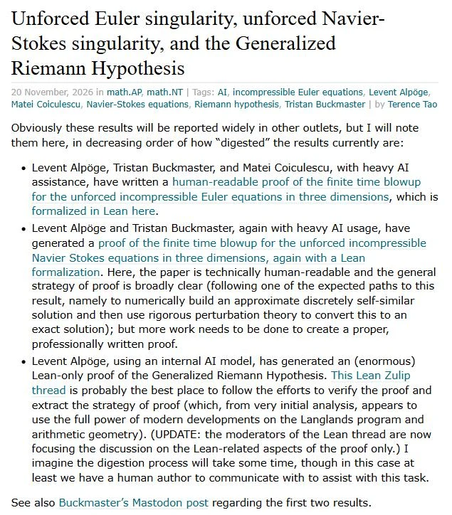

import LoopVideo from "@/components/LoopVideo.astro";
import YouTubeEmbed from "@/components/YouTubeEmbed.astro";
import neuralinkMp4 from "./neuralink.mp4";
import neuralinkWebm from "./neuralink.webm";
import TimeHorizon from "@/components/blog/ai-next-year/TimeHorizon.astro";

Ngày này năm sau, tôi nghĩ AI sẽ giải quyết được khoảng 90% vấn đề của con người, từ chuyện làm ra đủ lương thực cho tới chữa những bệnh như ung thư.

Nói ra thì nghe hơi điên, nên tôi ghi lại ở đây, có ngày tháng đàng hoàng, để đúng một năm nữa mở ra xem mình sai bao xa. Dưới đây là những thứ làm tôi nghĩ vậy.

## AI đang chạy nhanh cỡ nào

METR có một cách đo khá dễ hiểu: đưa cho model một việc lập trình, rồi xem việc dài nhất mà nó làm xong được một nửa số lần là bao lâu, tính theo thời gian một người làm. Giữa 2024, GPT-4o chỉ làm được việc cỡ 6 phút. Tới tháng 2/2026, Claude Opus 4.6 làm được việc cỡ 12 tiếng, tức hơn một ngày rưỡi đi làm. Cứ khoảng 3,5 tháng con số này lại gấp đôi[^metr], và tới giữa năm nay thì METR hết bài đủ khó để đo tiếp.

<TimeHorizon />

Model chạy ở nhà cũng đuổi theo rất sát. Epoch AI tính ra rằng chỉ với một card chơi game như RTX 5090, bạn đã chạy được model có điểm benchmark ngang model mạnh nhất thế giới của 6 đến 12 tháng trước[^epoch]. Dùng thật thì chắc vẫn thua một chút, vì model nhỏ hay được tối ưu riêng cho benchmark. Dù sao thì khoảng cách giờ chỉ còn tính bằng tháng.

Ảnh và video thì còn dễ thấy hơn. Tháng 3/2023, có người trên Reddit dùng ModelScope tạo một clip Will Smith ăn mì Ý. Mặt ông méo mó, sợi mì bay lung tung, nhìn ám ảnh tới mức clip thành meme, rồi thành luôn một bài test không chính thức cho model video. Tháng 5/2025, Veo 3 của Google làm lại đúng cảnh đó, mặt ra mặt, có cả tiếng nhai (hơi giòn so với mì). Tới tháng 2/2026, Forbes viết rằng Seedance 2.0 đã qua bài test này[^spaghetti]. Chỉ trong ba năm, nó đi từ một clip để cười tới mức khó phân biệt với video quay thật.

<YouTubeEmbed id="Tmfv3ijFtPY" title="Will Smith Eating Spaghetti: AI Evolution 2023-2026" />

Ra khỏi màn hình cũng vậy. Tháng 4/2021, Neuralink cho xem con khỉ Pager chơi Pong bằng não. Năm năm sau, một bệnh nhân của họ lái thủy phi cơ trong GTA VI chỉ bằng suy nghĩ, điều khiển cùng lúc hai joystick và 12 nút. Trước khi gắn chip, anh ấy phải ngậm một cây que để bấm iPad[^neuralink].

<LoopVideo
  webm={neuralinkWebm}
  mp4={neuralinkMp4}
  width={480}
  height={540}
  label="Trên: khỉ Pager chơi Pong bằng não năm 2021. Dưới: bệnh nhân Neuralink lái thủy phi cơ trong GTA VI bằng suy nghĩ năm 2026."
/>

Nhưng chuyện làm tôi muốn viết bài này là toán. Ngày 15/10, Terence Tao, người được xem là một trong những nhà toán học giỏi nhất còn sống, lên Numberphile và được hỏi giả thuyết Riemann có sắp bị giải không. Ông nói chắc các công ty AI đã lén dồn sức vào nó nhiều hơn họ công bố, nhưng vẫn "couldn't touch it". Theo ông phải có thứ gì đó vượt xa AI bây giờ, và có lẽ phải tới khoảng năm 2050, người với AI cùng làm, mới đi tiếp được[^tao2050].

Ngày 20/11, Levent Alpöge, một nhà toán học đang làm ở Anthropic, đăng chứng minh cho giả thuyết Riemann tổng quát (GRH). Anh làm chung với Claude, và toàn bộ được viết bằng Lean, một ngôn ngữ để máy kiểm tra chứng minh toán từng bước một. Theo log của anh, cả quá trình mất 41 ngày, bắt đầu từ đầu tháng 10, tức là đúng cái tuần Tao trả lời phỏng vấn[^tao2050]. Andrew Sutherland ở MIT và vài người khác đã chạy thử và xác nhận bản Lean compile được[^techcrunch]. Cùng lúc đó, Alpöge và cộng sự còn đăng thêm hai chứng minh cho phương trình Euler và Navier-Stokes, cũng nhờ AI rất nhiều[^taoblog].

Compile được chỉ có nghĩa là máy thấy từng bước đều đúng. Tới giờ vẫn chưa ai hiểu chứng minh đó đi theo con đường nào, và chính Tao cũng nói sẽ cần thời gian để "tiêu hóa"[^taoblog]. Dù vậy, nếu chứng minh này đứng vững thì dự đoán "khoảng 2050" đã sai gần 24 năm. Có người dành cả đời cho một bài toán, còn lần này AI và một nhà toán học làm xong trong một tháng rưỡi.

## Nếu các ngành khác cũng có "Riemann"

Toán có một lợi thế rất lớn: kiểm tra đúng sai gần như tức thì, Lean chạy xong là biết. Mấy ngành khác không sướng vậy. Tôi tin RSI (recursive self-improvement, AI tự cải thiện chính nó) đã được đem ra dùng ngoài đời rồi, chỉ là vòng feedback ở phòng thí nghiệm chậm hơn LLM nhiều nên mình chưa thấy ngay. Qua năm sau chắc sẽ thấy nghiên cứu ra liên tục, từ sinh học, hóa học tới vật lý.

Tôi hỏi thử Claude Fable 5.2 xem mỗi ngành có "Riemann" nào, tức là một tin lớn cỡ đó, kiểm chứng mất bao lâu, và khả năng có trước 2031 nếu AI làm phần lớn. Các con số dưới đây chỉ là phỏng đoán của model, không phải dữ liệu.

| Ngành | Tin "ngang Riemann" | Kiểm chứng mất | Fable đoán tới 2031 |
| --- | --- | --- | --- |
| Khoa học máy tính | Chứng minh P ≠ NP | Vài tuần (Lean) | 2% |
| Sinh học | Mô hình một tế bào vi khuẩn chỉ từ genome | Vài tháng | 10% |
| Năng lượng | Nhà máy nhiệt hạch đưa điện lên lưới | Vài tháng | 8% |
| Vật liệu | Siêu dẫn ở nhiệt độ phòng, áp suất thường | Vài tuần | 3% |
| Y học | Thuốc chặn Alzheimer qua thử nghiệm phase 3 | 5 đến 8 năm | 3% |
| Nông nghiệp | Lúa mì tự cố định đạm qua thử nghiệm ngoài đồng | 3 đến 5 năm | 3% |
| Lão hóa | Liệu pháp kéo dài tuổi thọ khỏe mạnh ở người | Trên 10 năm | Dưới 1% |

Cột đáng xem nhất là cột "kiểm chứng mất". Ngành nào kiểm được bằng máy tính hoặc thí nghiệm rẻ thì có cơ hội chạy nhanh như toán. Ngành nào phải chờ cơ thể người, cây trồng hay khí hậu phản ứng thì kẹt ở thời gian. Như Fable nói, thử nghiệm 18 tháng thì vẫn là 18 tháng. AI có thể tìm ra thuốc nhanh hơn, nhưng thuốc vẫn phải thử trên người thật. Nên nếu dự đoán 90% của tôi sai, chắc nó sai ở chỗ này.

## Có việc làm mới không

Mỗi lần có cách mạng công nghiệp, người ta lại sợ mất việc, và lần nào cuối cùng cũng có việc mới mọc ra. Năm 1900, khoảng 40% lao động Mỹ làm nông. Bây giờ còn chưa tới 2%, mà số người đó đâu có ngồi không, họ đi làm những nghề hồi 1900 chưa ai nghĩ ra.

Nhưng có một nhóm đã không chuyển nghề được: con ngựa. Đầu thế kỷ 20, Mỹ có hơn 20 triệu con ngựa kéo xe, cày ruộng. Rồi động cơ đốt trong ra đời, và chẳng có nghề mới nào dành cho ngựa cả.

Máy móc trước đây thay cơ bắp, nên con người chuyển qua dùng đầu óc. Lần này AI thay luôn cái đầu. Nó có tạo ra việc mới cho con người không, hay tự đẻ ra vấn đề rồi tự giải luôn? Tôi chưa biết lần này mình sẽ là người nông dân năm 1900, hay là con ngựa.

## Con người sẽ làm gì

Giả sử tôi đoán đúng: AI lo được đồ ăn, bệnh tật và phần lớn công việc, không ai còn bị bắt phải đi làm để sống nữa.

Tôi từng đọc được một câu hỏi ở đâu đó trên mạng, nghe khá triết học: con người sẽ chọn làm gì khi không còn bị bắt phải làm để sống?

Với tôi, kể cả có tiến tới cộng sản đi nữa thì cũng phải trả lời được câu này trước đã. Mà tôi thì chưa trả lời được.

Năm 1930, Keynes đoán tới đời cháu chắt ông, người ta chỉ cần làm khoảng 15 tiếng một tuần, và cái khó nhất sẽ là sống sao cho đáng với đống thời gian rảnh[^keynes]. Gần trăm năm sau, phần lớn chúng ta vẫn làm 40 tiếng, có khi hơn.

Hôm 20/11 còn một chuyện nữa. Cùng ngày Alpöge đăng chứng minh, Ravi Vakil ở Stanford đăng thêm một chứng minh GRH khác, của postdoc Alessandro Masullo. Cái này viết hoàn toàn bằng tay, không dùng AI, mất 12 năm. Nó chưa có bản Lean nên chưa ai biết đúng hay sai. Masullo gửi lời tới những nhà toán học đang nản: "we are still here. We are very much alive"[^techcrunch].

Tôi không biết như vậy có tính là câu trả lời không. Chỉ biết có người đã theo một bài toán suốt 12 năm, và ngay cả khi AI về đích cùng ngày, vẫn muốn ở lại làm tiếp.

## Hẹn năm sau

Đây là những gì tôi đoán hôm nay, 21/11/2026. Năm sau tôi sẽ quay lại chấm điểm.

| Dự đoán | Hạn | Kết quả |
| --- | --- | --- |
| AI giải quyết được khoảng 90% vấn đề của con người, ví dụ lương thực, bệnh tật | 21/11/2027 | ? |
| Nghiên cứu lớn có AI ra liên tục trong sinh học, hóa học, vật lý | 21/11/2027 | ? |

Còn câu hỏi về việc con người sẽ làm gì thì tôi không đặt hạn. Có khi phải lâu hơn một năm mới có người trả lời được.

[^metr]: METR, ["Time Horizon 1.1"](https://metr.org/blog/2026-01-29-time-horizon-1-1/), 29/1/2026, và trang [time horizons](https://metr.org/time-horizons/).
[^epoch]: Epoch AI, ["Frontier AI performance becomes accessible on consumer hardware within a year"](https://epoch.ai/data-insights/consumer-gpu-model-gap), 15/8/2025.
[^spaghetti]: Wikipedia, ["Will Smith eating spaghetti test"](https://en.wikipedia.org/wiki/Will_Smith_eating_spaghetti_test).
[^neuralink]: X Freeze, [tweet ngày 21/11/2026](https://x.com/XFreeze/status/2124030861653999815).
[^tao2050]: OfficeChai, ["Terence Tao Had Said A Month Ago That AI Could Solve Riemann Hypothesis Only By 2050"](https://officechai.com/ai/terence-tao-had-a-month-ago-that-ai-could-solve-riemann-hypothesis-only-by-2050/), 21/11/2026. Phỏng vấn gốc: Numberphile, "No More Heroes", 15/10/2026.
[^techcrunch]: TechCrunch, ["AI claimed a solution to the 167-year-old Riemann hypothesis, and a human did, too"](https://techcrunch.com/2026/11/20/ai-claimed-a-solution-to-the-167-year-old-riemann-hypothesis-and-a-human-did-too/), 20/11/2026.
[^taoblog]: Terence Tao, ["Unforced Euler singularity, unforced Navier-Stokes singularity, and the Generalized Riemann Hypothesis"](https://terrytao.wordpress.com/2026/11/20/unforced-euler-singularity-unforced-navier-stokes-singularity-and-the-generalized-riemann-hypothesis/), 20/11/2026.
[^keynes]: John Maynard Keynes, "Economic Possibilities for our Grandchildren", 1930.
